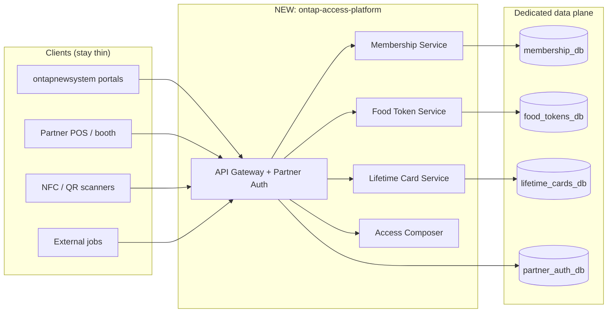
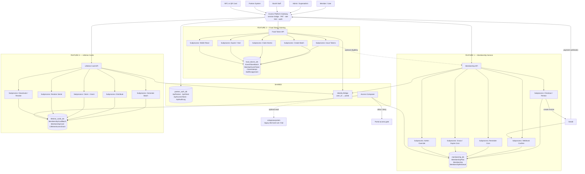
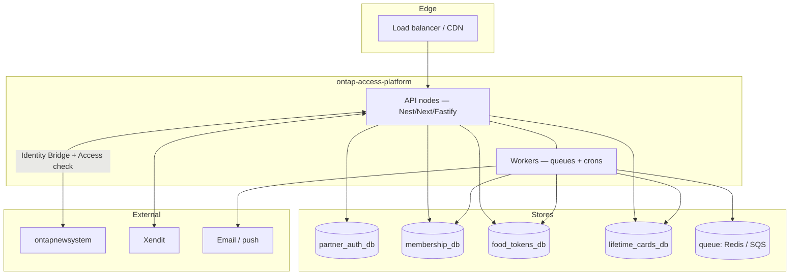
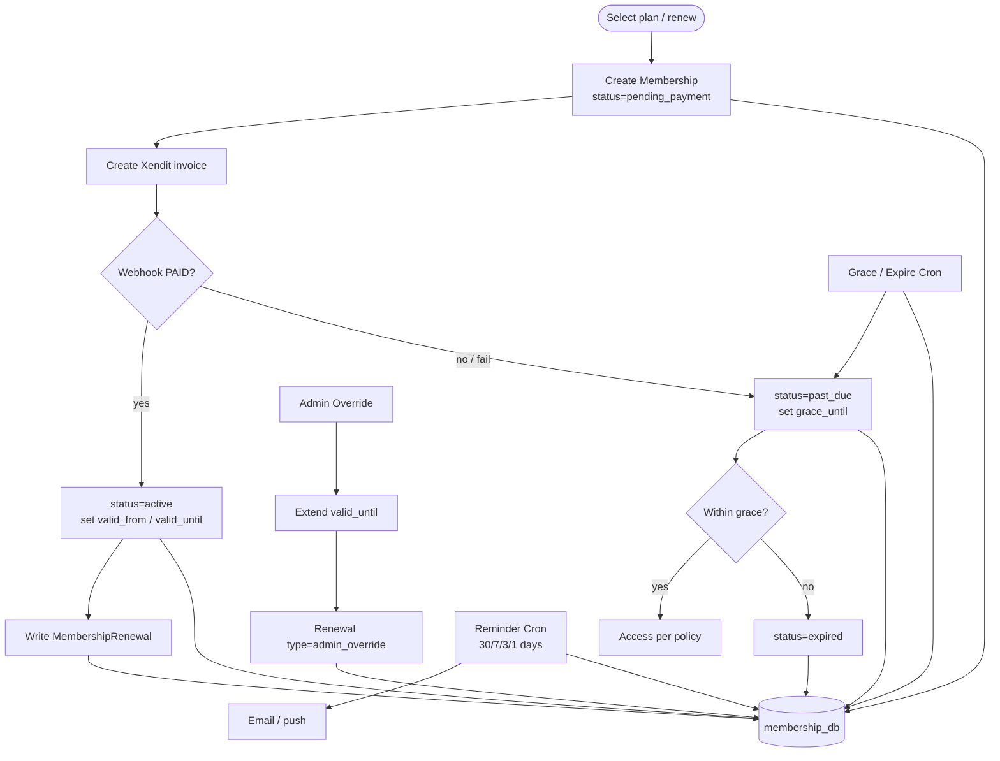
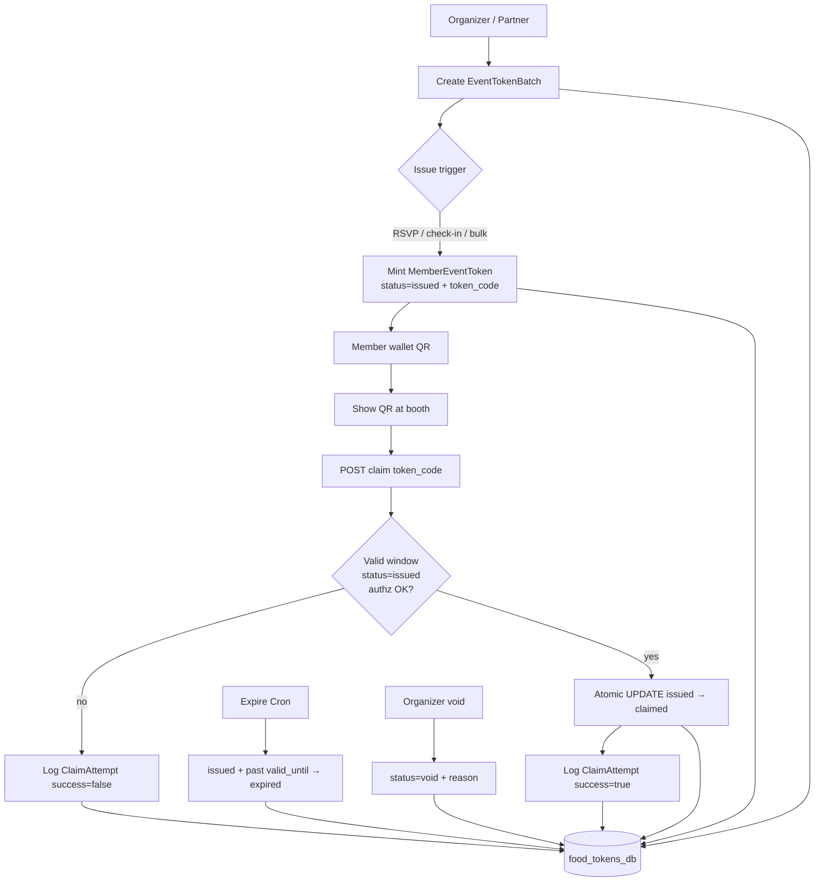
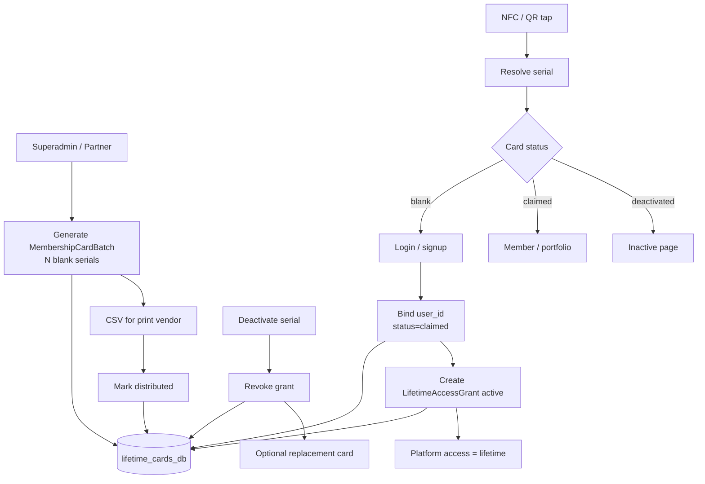
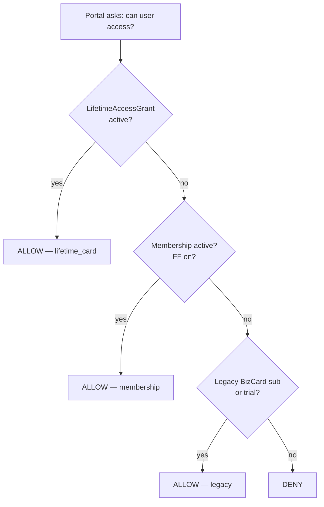
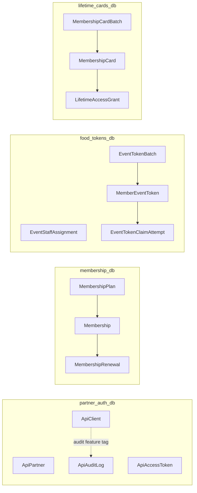
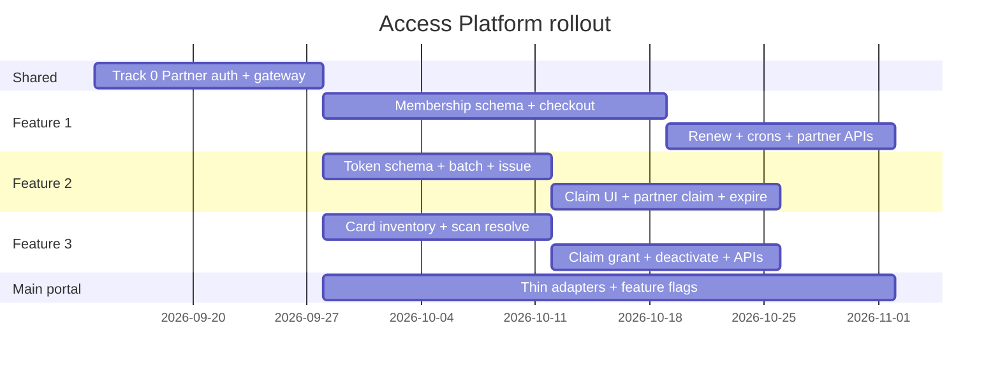

# OnTap Access Platform — Separate System Architecture

**Document:** `IMPLEMENTATION-REPORT.md`  
**Status:** Planning only — **no codebase changes** in this document  
**Date:** September 7, 2026 (refactored)  
**Why separate:** `ontapnewsystem` is already heavy (portal, e-market, portfolios, events, payments, NFC scan). Bolting Membership, Food Tokens, and Lifetime Cards into it will increase blast radius, deploy risk, and DB load as usage grows.

---

## Table of Contents

1. [Why a Separate System](#1-why-a-separate-system)
2. [The Three Features](#2-the-three-features)
3. [Master System Flowchart](#3-master-system-flowchart)
4. [Deployment Topology](#4-deployment-topology)
5. [Shared Layer — Gateway, Auth, Identity Bridge](#5-shared-layer--gateway-auth-identity-bridge)
6. [Feature 1 — Membership Service](#6-feature-1--membership-service)
7. [Feature 2 — Food Token Claiming](#7-feature-2--food-token-claiming)
8. [Feature 3 — NFC/QR Lifetime Cards](#8-feature-3--nfcqr-lifetime-cards)
9. [Cross-Feature Access Composition](#9-cross-feature-access-composition)
10. [Databases Map (All Schemas)](#10-databases-map-all-schemas)
11. [Partner API Catalog](#11-partner-api-catalog)
12. [Security Model](#12-security-model)
13. [Phased Rollout](#13-phased-rollout)
14. [Risks & Open Decisions](#14-risks--open-decisions)
15. [Document Control](#15-document-control)

---

## 1. Why a Separate System

### Problem

| Pressure on `ontapnewsystem` | Consequence if features are inlined |
|---|---|
| One MySQL + Prisma schema for everything | Migrations and lock contention grow with every new table |
| One Next.js deploy for portal + APIs | Food-token booth traffic can starve membership / portfolio requests |
| Shared session/payment/event codepaths | A bug in claim logic can take down unrelated portal surfaces |
| Partner POS + Xendit + NFC scans mixed in | Harder to scale, observe, and roll back one product at a time |

### Decision

Build a **separate Access Platform** (working name: `ontap-access-platform`) that owns the three products end-to-end:

| Owns | Does not own |
|---|---|
| Membership billing periods | BizCard marketing / portfolio UI |
| Event food-token wallets & claims | Full calendar / RSVP product (reads events via bridge) |
| Lifetime card inventory & grants | E-market merch / themes |
| Partner OAuth + feature scopes | Human login UI (delegates to main portal identity) |

`ontapnewsystem` becomes a **client**: portals call Access Platform APIs; optional thin adapters answer “does this user have access?” without owning the domain data.



---

## 2. The Three Features

| # | Feature | Product question | Own DB | Own workers |
|---|---|---|---|---|
| **1** | **Membership Service** | Does this person have a paid/complimentary membership period, and how do renewals work? | `membership_db` | Reminder cron, grace/expire cron, Xendit webhook worker |
| **2** | **Food Token Claiming** | How do event attendees receive and redeem meal/drink tokens at a booth? | `food_tokens_db` | Issue worker, expire/void cron, claim audit |
| **3** | **NFC/QR Lifetime IDs** | How do physical cards grant free lifetime platform access when claimed? | `lifetime_cards_db` | Batch provision, claim, deactivate / revoke |

Plus shared infrastructure (not a product feature):

| Shared | Purpose |
|---|---|
| Partner API + Access Tokens | External systems call `/v1/*` with scoped Bearer tokens |
| Identity Bridge | Map `user_id` / `external_ref` from main portal without copying full User tables |
| Access Composer | Optional `OR` of lifetime grant + membership + legacy portal signals |

**Hard rule:** Food Tokens and Lifetime Cards must work if Membership is offline or disabled.

---

## 3. Master System Flowchart

This is the single map of how the separate system accommodates **all three features**: entry points → gateway → feature subprocesses → databases → optional callbacks to the main portal.



### How to read the master chart

1. **All traffic enters one gateway** — humans via portal session bridge, partners via PAT, Xendit via signed webhooks, cards via public scan URLs.
2. **Each feature is a vertical slice** — its own API, subprocesses, and database. No shared “god” membership hub.
3. **Subprocesses are the unit of scale** — e.g. claim traffic scales the Food Token claim worker without touching Membership renewals.
4. **Optional dashed edges** — Food Tokens may ask Membership for eligibility; Access Composer may ask the main portal for legacy trial/sub. Both are adapters, not hard FKs.

---

## 4. Deployment Topology

Prefer **one deployable platform with three isolated data stores** first; split into separate services later if traffic demands it.



| Component | Responsibility |
|---|---|
| API nodes | Portal BFF routes + Partner `/v1/*` |
| Workers | Reminders, expire/void, webhook retries, batch issue |
| Queues | Decouple claim spikes and webhook storms from request path |
| Four DBs | Blast-radius isolation; independent backups and scaling |

**Feature flags (platform-side):**

| Flag | Feature |
|---|---|
| `FF_MEMBERSHIP_SERVICE` | Feature 1 |
| `FF_FOOD_TOKENS` | Feature 2 |
| `FF_LIFETIME_CARDS` | Feature 3 |
| `FF_PARTNER_API` | Shared Partner layer |

---

## 5. Shared Layer — Gateway, Auth, Identity Bridge

### 5.1 Credential types

| Credential | Who | Lifetime | Purpose |
|---|---|---|---|
| Portal session bridge token | Humans (via main portal) | Short | Call Access Platform from UI |
| Partner Client ID + Secret | External backends | Long-lived | Exchange for PAT |
| Partner Access Token (PAT) | External backends | ~1 hour | Call `/api/v1/*` |
| Cron / webhook secrets | Workers / Xendit | Env-bound | Jobs & payments |

### 5.2 Partner auth database (`partner_auth_db`)

```prisma
model ApiPartner {
  id            BigInt   @id @default(autoincrement())
  name          String
  company_id    BigInt?
  status        String   @default("active") // active | suspended | revoked
  contact_email String?
  created_at    DateTime @default(now())
  updated_at    DateTime @updatedAt
}

model ApiClient {
  id                 BigInt   @id @default(autoincrement())
  partner_id         BigInt
  client_id          String   @unique
  client_secret_hash String
  scopes             String   @db.Text      // JSON string[]
  allowed_ips        String?  @db.Text
  rate_limit_rpm     Int      @default(120)
  status             String   @default("active")
  created_at         DateTime @default(now())
  last_used_at       DateTime?
}

model ApiAccessToken {
  id          BigInt    @id @default(autoincrement())
  client_id   BigInt
  token_hash  String    @unique
  scopes      String    @db.Text
  expires_at  DateTime
  revoked_at  DateTime?
  created_at  DateTime  @default(now())
}

model ApiAuditLog {
  id            BigInt   @id @default(autoincrement())
  client_id     BigInt?
  partner_id    BigInt?
  method        String
  path          String
  status_code   Int
  feature       String?                 // membership | food_tokens | lifetime_cards
  resource_type String?
  resource_id   String?
  action        String
  ip            String?
  request_id    String?
  created_at    DateTime @default(now())
  @@index([partner_id, created_at])
  @@index([feature, created_at])
}
```

### 5.3 Token exchange

```
POST /api/v1/oauth/token
  grant_type=client_credentials
  client_id=...
  client_secret=...

→ { access_token, token_type: Bearer, expires_in: 3600, scope: "..." }
```

All mutating partner calls require `Idempotency-Key`.

### 5.4 Scope catalog (feature-separated)

| Feature | Scopes |
|---|---|
| Membership | `membership:read` · `membership:write` · `membership:renew` |
| Food Tokens | `tokens:read` · `tokens:issue` · `tokens:claim` |
| Lifetime Cards | `cards:read` · `cards:provision` · `cards:claim` |

A POS client can hold **only** `tokens:claim` + `tokens:read`.

### 5.5 Identity Bridge

Access Platform stores `user_id` (from main portal) and optional `external_ref` — it does **not** duplicate full user profiles.

```
Portal session → bridge token { user_id, roles }
Partner API    → body/path user_id or external_ref
```

---

## 6. Feature 1 — Membership Service

### 6.1 Definition

Commercial access & billing: plans, enrollment, Xendit renewals, grace, history.  
**Not** required for Food Tokens or Lifetime Cards.

### 6.2 Database (`membership_db`)

```prisma
model MembershipPlan {
  id             BigInt   @id @default(autoincrement())
  code           String   @unique
  name           String
  duration_days  Int
  price_cents    Int
  currency       String   @default("PHP")
  features_json  String   @db.Text
  is_active      Boolean  @default(true)
  created_at     DateTime @default(now())
}

model Membership {
  id                BigInt    @id @default(autoincrement())
  user_id           BigInt
  company_id        BigInt?
  plan_id           BigInt?
  status            String    // pending_payment | active | past_due | expired | suspended
  valid_from        DateTime?
  valid_until       DateTime?
  grace_until       DateTime?
  source            String    // purchase | admin_grant | partner_api
  linked_bizcard_id BigInt?
  external_ref      String?
  created_at        DateTime  @default(now())
  updated_at        DateTime  @updatedAt
  @@index([user_id, status])
  @@index([external_ref])
}

model MembershipRenewal {
  id               BigInt   @id @default(autoincrement())
  membership_id    BigInt
  renewal_type     String   // initial | auto | manual | partner | admin_override
  previous_until   DateTime?
  new_until        DateTime?
  amount_cents     Int?
  currency         String?
  payment_provider String?
  payment_ref      String?
  actor_user_id    BigInt?
  api_client_id    BigInt?
  notes            String?  @db.Text
  created_at       DateTime @default(now())
  @@index([membership_id, created_at])
}
```

> Lifetime access is **owned by Feature 3**, not a Membership status.

### 6.3 Subprocesses & flowchart



| Subprocess | Trigger | Writes |
|---|---|---|
| Checkout / Renew | User, partner, portal | `Membership`, invoice ref |
| Webhook Confirm | Xendit `INVOICE_PAID` | status, dates, `MembershipRenewal` |
| Reminder Cron | Schedule | notifications only |
| Grace / Expire Cron | Schedule | `past_due` → `expired` |
| Admin Override | Superadmin | dates + audited renewal row |

### 6.4 Service functions

| Function | Responsibility |
|---|---|
| `getMembership(userId)` | Current record(s) |
| `isMembershipActive(userId)` | Boolean for composers / optional token eligibility |
| `startMembershipCheckout(...)` | Invoice creation |
| `confirmMembershipPayment(paymentRef)` | Idempotent webhook |
| `startRenewal(...)` | Renewal invoice |
| `markPastDue` / `expireMembership` | Cron |
| `adminOverrideExtend(...)` | Audited extension |
| `backfillFromBizcardSubscriptions()` | One-time migration from main portal |

---

## 7. Feature 2 — Food Token Claiming

### 7.1 Definition

Event operations: batches, issue, wallet QR, atomic booth claim.  
Depends on **event id + users** (via Identity Bridge / event read API).  
Does **not** depend on Membership (optional eligibility adapter only).

### 7.2 Database (`food_tokens_db`)

```prisma
model EventStaffAssignment {
  id            BigInt   @id @default(autoincrement())
  event_id      BigInt
  user_id       BigInt?
  api_client_id BigInt?
  role          String                 // scanner | booth | organizer
  created_at    DateTime @default(now())
  @@index([event_id])
}

model EventTokenBatch {
  id                   BigInt   @id @default(autoincrement())
  event_id             BigInt
  name                 String
  token_type           String              // food | drink | merch | custom
  quantity_per_member  Int      @default(1)
  eligibility          String              // rsvp_going | checked_in | invite_list | membership_active | custom
  dietary_options_json String?  @db.Text
  valid_from           DateTime
  valid_until          DateTime
  status               String   @default("active")
  created_by           BigInt?
  created_at           DateTime @default(now())
  updated_at           DateTime @updatedAt
  @@index([event_id, status])
}

model MemberEventToken {
  id                   BigInt    @id @default(autoincrement())
  batch_id             BigInt
  event_id             BigInt
  user_id              BigInt
  token_code           String    @unique
  status               String    @default("issued") // issued | claimed | expired | void
  issued_at            DateTime  @default(now())
  claimed_at           DateTime?
  claimed_by_staff_id  BigInt?
  claimed_by_client_id BigInt?
  void_reason          String?
  meta_json            String?   @db.Text
  @@unique([batch_id, user_id])
  @@index([event_id, status])
  @@index([user_id, status])
}

model EventTokenClaimAttempt {
  id         BigInt   @id @default(autoincrement())
  token_code String
  success    Boolean
  reason     String?
  actor_id   String?
  ip         String?
  created_at DateTime @default(now())
  @@index([token_code, created_at])
}
```

### 7.3 Subprocesses & flowchart



| Subprocess | Trigger | Notes |
|---|---|---|
| Create Batch | Admin / partner | Eligibility rule stored on batch |
| Issue Tokens | RSVP, check-in, manual, partner | Idempotent per `(batch_id, user_id)` |
| Claim Atomic | Staff UI / POS | `UPDATE … WHERE status='issued'` |
| Expire / Void | Cron / organizer | Audited |
| Wallet Read | Member / partner | QR payload |

### 7.4 Anti-fraud

1. Atomic status transition  
2. High-entropy `token_code`  
3. Rate-limit claim  
4. Optional booth assignment check  
5. Claim attempt logging  
6. Optional signed/expiring QR wrapper  

---

## 8. Feature 3 — NFC/QR Lifetime Cards

### 8.1 Definition

Physical credential inventory + **lifetime platform access grant**.  
Independent from Membership billing cycles.

### 8.2 Database (`lifetime_cards_db`)

```prisma
model MembershipCardBatch {
  id              BigInt   @id @default(autoincrement())
  code            String   @unique
  label           String
  card_type       String                 // membership_lifetime
  quantity        Int
  created_by      BigInt?
  created_at      DateTime @default(now())
}

model MembershipCard {
  id                 BigInt    @id @default(autoincrement())
  batch_id           BigInt?
  serial_id          String    @unique
  card_type          String
  access_type        String                  // lifetime
  status             String    @default("blank") // blank | claimed | deactivated
  user_id            BigInt?
  bizcard_id         BigInt?
  distributed_at     DateTime?
  distributed_by     BigInt?
  claimed_at         DateTime?
  deactivated_at     DateTime?
  deactivated_reason String?
  created_at         DateTime  @default(now())
  @@index([batch_id])
  @@index([status])
}

model LifetimeAccessGrant {
  id              BigInt    @id @default(autoincrement())
  user_id         BigInt
  card_id         BigInt?
  serial_id       String?
  status          String    @default("active") // active | revoked
  granted_at      DateTime  @default(now())
  granted_by      BigInt?
  api_client_id   BigInt?
  revoked_at      DateTime?
  revoke_reason   String?
  @@index([user_id, status])
}
```

### 8.3 Encoding

```
https://{access-or-portal-host}/m/{SERIAL_ID}
```

| Serial state | Result |
|---|---|
| Blank | Signup/login → claim lifetime |
| Claimed | Member home + lifetime badge |
| Deactivated | “Card inactive” |

### 8.4 Subprocesses & flowchart



| Subprocess | Trigger | Writes |
|---|---|---|
| Generate Batch | Superadmin / `cards:provision` | batch + N blank cards |
| Distribute | Ops | `distributed_at` |
| Resolve Serial | Public scan | read-only |
| Claim + Grant | User / assisted partner | card + `LifetimeAccessGrant` |
| Deactivate / Revoke | Superadmin / partner | card + grant |

### 8.5 Main-portal thin hooks (only)

| Existing in `ontapnewsystem` | Change |
|---|---|
| Scan router | Forward lifetime serials to Access Platform resolve/claim |
| Expiry emails | Skip users with active lifetime grant (composer check) |
| Subscribe CTA | Hide for lifetime grantees |

---

## 9. Cross-Feature Access Composition

Optional adapters only. Each feature must work alone.



| Optional integration | Direction | Behavior |
|---|---|---|
| Token eligibility | Food Tokens → Membership | Batch rule `membership_active` |
| VIP token quantity | Food Tokens → Membership | Higher qty per plan |
| Hide renew upsell | Membership UI → Lifetime | If lifetime grant, hide renew CTA |
| Partner bundles | Ops | Multiple scopes on one client; still separate APIs |

**No feature writes another feature’s primary tables** except through these adapters.

---

## 10. Databases Map (All Schemas)



| DB | Primary load pattern | Scale note |
|---|---|---|
| `partner_auth_db` | Token issue + audit writes | Small; high read on validate |
| `membership_db` | Webhooks + renewals | Spiky around billing cycles |
| `food_tokens_db` | Claim writes at event peaks | Highest write burst — isolate first |
| `lifetime_cards_db` | Claim once per card; resolve reads | Inventory + grant lookups |

Logical separation can start as **four MySQL schemas on one server**; move to separate instances when Food Token claim volume warrants it.

---

## 11. Partner API Catalog

### Membership

| Method | Path | Scope / role |
|---|---|---|
| GET | `/api/user/membership` | User session |
| POST | `/api/user/membership/renew` | User session |
| GET | `/api/v1/memberships/{userId}` | `membership:read` |
| GET | `/api/v1/memberships/by-external/{ref}` | `membership:read` |
| POST | `/api/v1/memberships` | `membership:write` |
| PATCH | `/api/v1/memberships/{id}` | `membership:write` |
| POST | `/api/v1/memberships/{id}/renew` | `membership:renew` |
| GET | `/api/v1/memberships/{id}/renewals` | `membership:read` |
| POST | `/api/superadmin/memberships/{id}/override` | Superadmin |

### Food Tokens

| Method | Path | Scope / role |
|---|---|---|
| POST/GET | `/api/admin/events/{eventId}/token-batches` | Admin |
| POST | `/api/admin/events/token-batches/{id}/issue` | Admin |
| GET | `/api/user/events/{eventId}/tokens` | User |
| POST | `/api/staff/events/tokens/claim` | Staff |
| POST | `/api/v1/events/{eventId}/token-batches` | `tokens:issue` |
| POST | `/api/v1/events/token-batches/{id}/issue` | `tokens:issue` |
| GET | `/api/v1/users/{userId}/tokens` | `tokens:read` |
| POST | `/api/v1/events/tokens/claim` | `tokens:claim` |
| POST | `/api/v1/events/tokens/{id}/void` | `tokens:issue` |

### Lifetime Cards

| Method | Path | Scope / role |
|---|---|---|
| POST | `/api/superadmin/membership-cards/generate` | Superadmin |
| GET | `/api/superadmin/membership-cards` | Superadmin |
| POST | `/api/superadmin/membership-cards/{serial}/deactivate` | Superadmin |
| POST | `/api/membership-cards/claim` | User session |
| GET | `/api/public/scan/{serialId}` | Public |
| POST | `/api/v1/cards/generate` | `cards:provision` |
| GET | `/api/v1/cards/{serial}` | `cards:read` |
| POST | `/api/v1/cards/{serial}/claim` | `cards:claim` |
| POST | `/api/v1/cards/{serial}/deactivate` | `cards:provision` |

### Shared OAuth

| Method | Path |
|---|---|
| POST | `/api/v1/oauth/token` |
| POST | `/api/v1/oauth/revoke` |

---

## 12. Security Model

| Caller | AuthN |
|---|---|
| Humans | Portal session → bridge token |
| Partners | Bearer PAT |
| Jobs | `CRON_SECRET` |
| Xendit | Callback verification |

**AuthZ rules**

1. Feature-separated scopes  
2. Least privilege defaults  
3. Tenant binding for partners  
4. Resource ownership on every write  
5. Idempotency on claim / renew / provision  
6. Lifetime grants **only** via Feature 3 paths  

| Threat | Mitigation |
|---|---|
| Double food claim | Atomic status transition |
| Serial guessing | Unguessable serials + rate limit |
| Partner secret leak | Hashed secrets, short PATs, IP allowlist |
| Cross-feature privilege | Scope middleware + feature tag on audit |
| Free renew abuse | Payment-required renewals; audited overrides |
| Lifetime card resale | Single activation; deactivate + reissue |

---

## 13. Phased Rollout

Ship **outside** `ontapnewsystem` as its own repo/deploy. Tracks A/B/C run in parallel after Track 0.



| Track | Deliverables |
|---|---|
| **0** | `partner_auth_db`, OAuth, scope middleware, audit, OpenAPI skeleton |
| **A** Membership | Schema, Xendit, portals via API, access adapter, partner routes |
| **B** Food Tokens | Batches, issue, wallet, staff claim, partner claim, expire cron |
| **C** Lifetime Cards | Batches, resolve, claim→grant, deactivate, partner provision |

**Main portal work stays thin:** Identity Bridge client, Access Composer check, scan forwarder, hide CTAs — no domain tables for these three features.

---

## 14. Risks & Open Decisions

### Risks

| Risk | Feature | Mitigation |
|---|---|---|
| Dual access truth during Membership migration | 1 | Dual-read with flag; fallback to BizCard in composer |
| Booth claim spikes overload shared DB | 2 | Dedicated `food_tokens_db` (+ queue) from day one |
| Lifetime card sharing / resale | 3 | One activation; replace policy |
| Accidental re-coupling into main monolith | All | Separate repo, separate DBs, CI boundary checks |
| Network hop latency portal → platform | All | Cache `isActive` / `hasLifetime` with short TTL |

### Dependencies

| Feature | Depends on |
|---|---|
| Membership | Xendit, notifications, Identity Bridge |
| Food Tokens | Event ids (read from main or event API), users, optional check-in |
| Lifetime Cards | Scan entrypoint, users |
| All Partner APIs | Track 0 |

### Open decisions

1. Lifetime only via Feature 3 cards, or also a Membership “lifetime plan”?  
2. Food token default eligibility: RSVP, check-in, or invite list?  
3. May partners provision lifetime cards, or superadmin only?  
4. Company seat memberships in Membership Phase 1 or 2?  
5. During `past_due` grace: full access or limited?  
6. Enforce one active `LifetimeAccessGrant` per user strictly?  
7. Deploy Access Platform as one service with 4 schemas first, or 3 microservices immediately?

---

## 15. Document Control

| Item | Value |
|---|---|
| Refactor reason | Treat the three features as a **separate system** so `ontapnewsystem` stays lighter under growth |
| Prior framing | Features as modules *inside* the monolith (superseded) |
| Related doc | `docs/FEATURE_INTEGRATION_RECOMMENDATIONS.md` (if present) |
| Code changes in this task | **None** |
| Recommended next step | Confirm §14 open decisions → scaffold `ontap-access-platform` repo + Track 0 |

---

*End of IMPLEMENTATION-REPORT.md*
