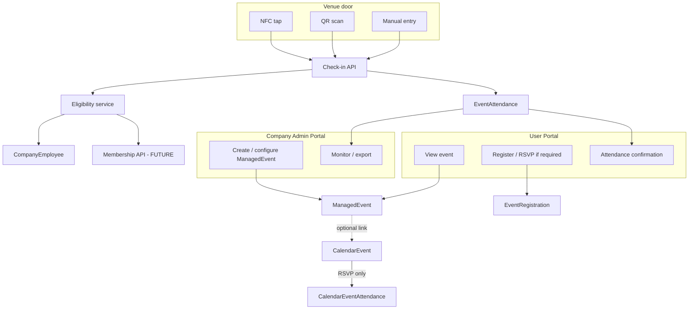
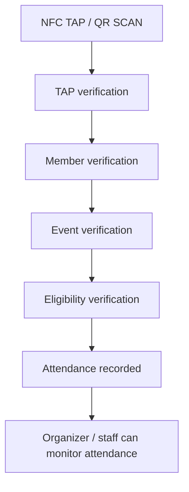
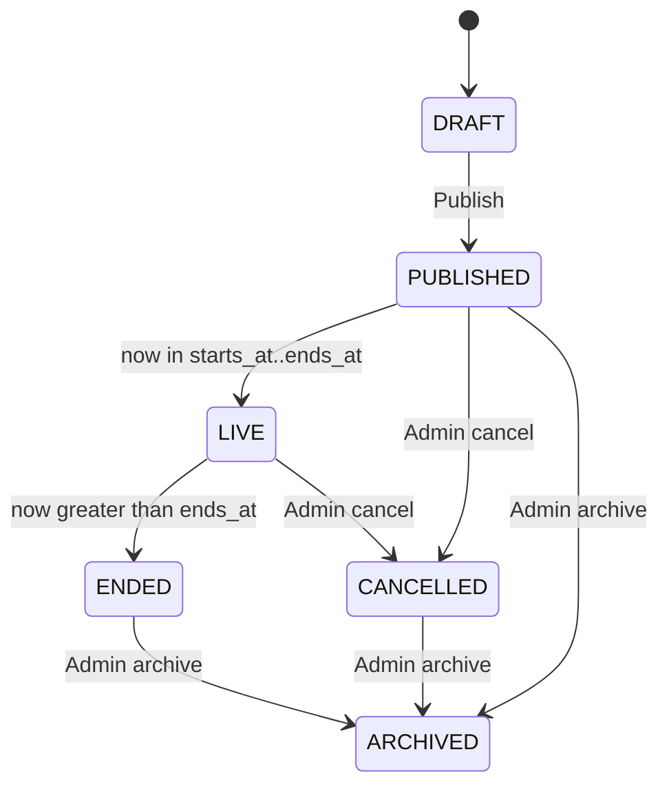
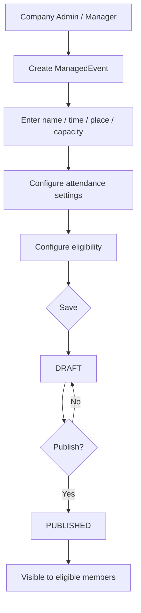
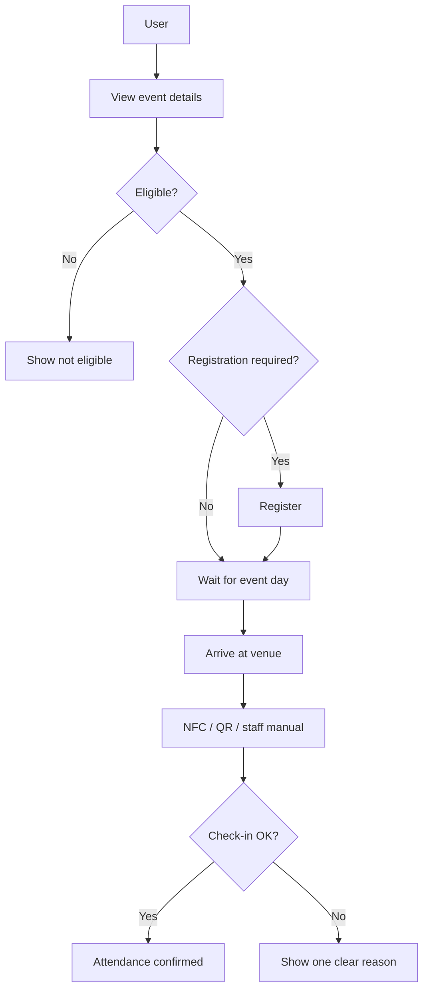
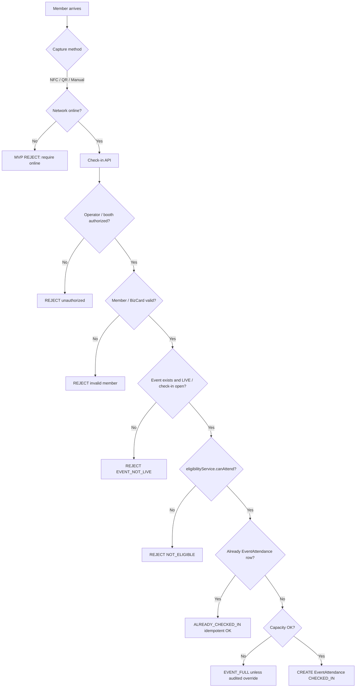
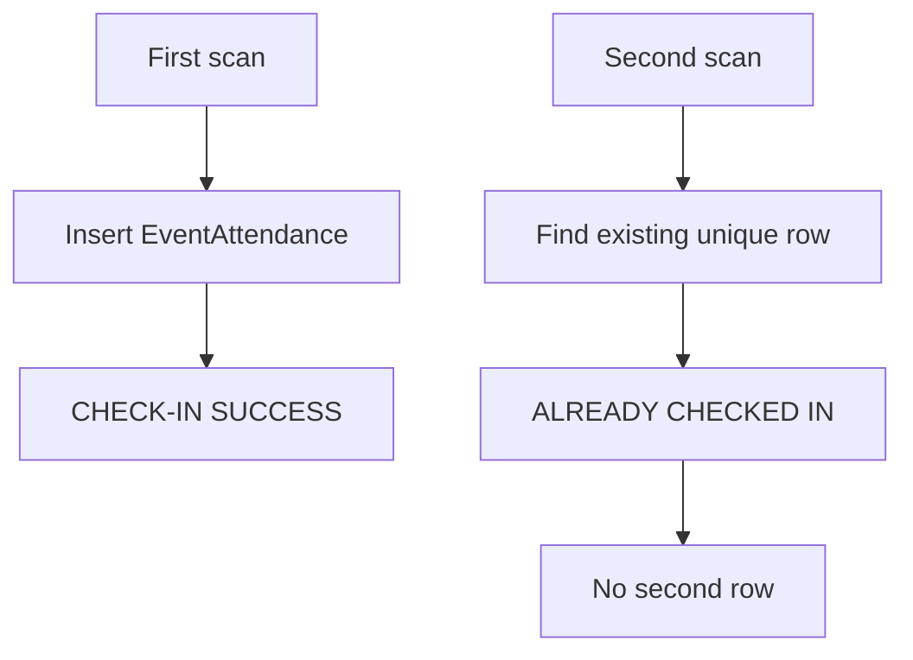
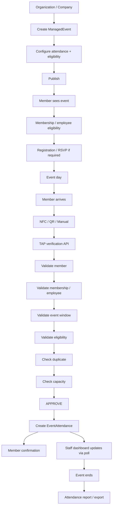

# Attendance & Event Monitoring — Visual Flowcharts

**Document version:** 1.1  
**Date:** September 7, 2026  
**Status:** Visual companion — Mermaid + PNG flowchart images  
**Scope:** Presentation-ready flowcharts for Attendance & Event Monitoring  

**Single source of truth:** [`Attendance & Event Monitoring.md`](Attendance%20&%20Event%20Monitoring.md)  
**PNG folder:** [`attendance-flowcharts/`](attendance-flowcharts/)

---

## How to use this document

Open this file in a Markdown previewer to see **PNG flowchart images** and Mermaid diagrams. Images are for presentation; Mermaid remains the editable source for structure.

---

## 1. System at a glance

**Source:** Architecture §§1–2, §6

---

## 2. Business door flow

**Source:** Architecture §2

---

## 5. Event lifecycle

**Source:** Architecture §8

---

## 6. Event creation

**Source:** Architecture §9, §35.2

---

## 7. Member event journey

**Source:** Architecture §10, §35.3

---

## 11. Attendance validation

**Source:** Architecture §14, §35.6, Whole Flow

---

## 12. Duplicate prevention

**Source:** Architecture §§15, 28, §35.7

---

## 27. End-to-end whole flow

**Source:** Architecture §35.17, Whole Flow

---

*Architecture source of truth: [`Attendance & Event Monitoring.md`](Attendance%20&%20Event%20Monitoring.md).*
