# Attendance & Event Monitoring

**Document version:** 1.0  
**Date:** September 5, 2026  
**Status:** Discovery / architecture only — **no implementation in this phase**  
**Scope:** `ontapnewsystem` (TAP portal)  
**Related:** [`docs/FEATURE_INTEGRATION_RECOMMENDATIONS.md`](FEATURE_INTEGRATION_RECOMMENDATIONS.md) §5.2 (prior proposal; this document supersedes ownership model for org monitoring)

---

## Table of Contents

1. [Executive Overview](#1-executive-overview)
2. [Business Objective](#2-business-objective)
3. [Why This Should Be Integrated Into TAP](#3-why-this-should-be-integrated-into-tap)
4. [Current TAP Architecture](#4-current-tap-architecture)
5. [Existing Features Relevant to Attendance](#5-existing-features-relevant-to-attendance)
6. [Proposed Attendance Architecture](#6-proposed-attendance-architecture)
7. [Event Concept](#7-event-concept)
8. [Event Lifecycle](#8-event-lifecycle)
9. [Event Creation Flow](#9-event-creation-flow)
10. [Member Event Experience](#10-member-event-experience)
11. [Membership Eligibility](#11-membership-eligibility)
12. [NFC Attendance Flow](#12-nfc-attendance-flow)
13. [QR Attendance Flow](#13-qr-attendance-flow)
14. [Check-in](#14-check-in)
15. [Duplicate Check-in Prevention](#15-duplicate-check-in-prevention)
16. [Check-out](#16-check-out)
17. [Attendance Status](#17-attendance-status)
18. [Event Monitoring](#18-event-monitoring)
19. [Staff Responsibilities](#19-staff-responsibilities)
20. [Manual Attendance](#20-manual-attendance)
21. [Attendance Correction](#21-attendance-correction)
22. [Offline / Network Failure](#22-offline--network-failure)
23. [Capacity Management](#23-capacity-management)
24. [Event Eligibility](#24-event-eligibility)
25. [Membership + Attendance Relationship](#25-membership--attendance-relationship)
26. [Database / Data Model Proposal](#26-database--data-model-proposal)
27. [API Integration Proposal](#27-api-integration-proposal)
28. [Idempotency](#28-idempotency)
29. [Security](#29-security)
30. [Audit Logging](#30-audit-logging)
31. [Reporting](#31-reporting)
32. [User Experience](#32-user-experience)
33. [Business Benefits](#33-business-benefits)
34. [Future Integration](#34-future-integration)
35. [Complete Flowcharts](#35-complete-flowcharts)
36. [Files / Modules Potentially Affected](#36-files--modules-potentially-affected)
37. [Open Questions](#37-open-questions)
38. [Recommended Implementation Phases](#38-recommended-implementation-phases)
39. [Final Architecture Recommendation](#39-final-architecture-recommendation)

---

## Label legend

| Label | Meaning |
|---|---|
| **[VERIFIED]** | Confirmed directly from the current codebase |
| **[PROPOSED]** | Recommended future architecture (not implemented) |
| **[NOT FOUND]** | Could not be verified in the current codebase |
| **[EXISTING]** | Current staff/role capability already present |
| **[FUTURE PHASE]** | Explicitly deferred; extension point only |

---

## 1. Executive Overview

**[PROPOSED]** Attendance & Event Monitoring should be a **company-owned Managed Event domain** with server-authoritative NFC/QR check-in, eligibility gates, monitoring, and export — separate from today’s personal calendar RSVP.

**[VERIFIED]** TAP already has identity (User + BizCard `serial_id`), physical NFC/QR URL resolve, company employees, opaque cookie sessions, calendar RSVP, notifications/crons, and audit log patterns. It does **not** have venue check-in, event capacity enforcement, booth scanner ops, or realtime attendance push.

**Why not extend only `CalendarEvent`?** Org monitoring, capacity, booth operators, and eligibility fit `Company` + `/admin` better than user-owned appointments. Personal RSVP remains useful for reminders/discovery via an **optional** link — without conflating “going” with physical presence.

| Concern | Today | Target (MVP) |
|---|---|---|
| Event ownership | User-owned `CalendarEvent` | Company-owned `ManagedEvent` |
| RSVP | `CalendarEventAttendance` (`going`) | Keep; optional link only |
| Venue attendance | **[NOT FOUND]** | `EventAttendance` + audit |
| Identity at door | BizCard/EmployeeCard serial URL | Reuse serial → user resolve |
| Monitoring | Manual refresh / list APIs | Short polling dashboard |
| Offline sync | **[NOT FOUND]** | Reject offline (MVP) |

---

## 2. Business Objective

Enable an organization (TAP **Company**) to:

1. Create and publish managed events.
2. Identify arriving people via TAP identity (BizCard NFC/QR `serial_id`).
3. Verify member/employee eligibility server-side.
4. Record unique physical attendance (check-in; optional check-out later).
5. Monitor live attendance (near-real-time).
6. Export accurate attendance reports.
7. Leave clean hooks for food tokens, voting, loyalty, networking, and missions **[FUTURE PHASE]**.

Conceptual door flow (business view):

```text
NFC TAP / QR SCAN
        ↓
TAP verification
        ↓
Member verification
        ↓
Event verification
        ↓
Eligibility verification
        ↓
Attendance recorded
        ↓
Organizer / staff can monitor attendance
```

---

## 3. Why This Should Be Integrated Into TAP

TAP already centralizes the hard parts of venue identity:

| Capability | Why it matters for attendance |
|---|---|
| User + session auth | Operators and members are already authenticated |
| BizCard `serial_id` + scan routing | Physical NFC/QR already map to a person |
| Company + `CompanyEmployee` | Natural org ownership and MVP eligibility |
| Notifications / calendar reminders | Event-day communication reuse |
| Audit log patterns | Corrections and manual check-ins need trails |
| Portal RBAC (`/admin`, `/user`, `/staff`, …) | Clear homes for create / attend / oversee |

Building attendance **outside** TAP would duplicate identity, NFC/QR media, and company roster — the opposite of TAP’s value.

---

## 4. Current TAP Architecture

### 4.1 Stack — [VERIFIED]

| Layer | Technology / location |
|---|---|
| Frontend | Next.js App Router, React, Tailwind under `app/` |
| Backend | Route handlers `app/api/**`; services `lib/services/**` |
| Database | MySQL via Prisma (`prisma/schema.prisma`); dual DB pattern (main + analytics) |
| Auth | Opaque DB sessions + httpOnly cookies in `server/lib/auth.ts` |
| Edge / proxy | `proxy.ts` — CSRF / CSP / CORS / cookie presence |
| Root middleware JWT sessions | **[NOT FOUND]** (no root `middleware.ts`) |

### 4.2 Portals — [VERIFIED]

From `app/config/portalNavigation.ts`:

| Portal | Path | Primary use today |
|---|---|---|
| User | `/user/*` | Individual members |
| Company Admin | `/admin/*` | Company admin surfaces (includes Company) |
| Staff | `/staff/*` | Platform staff + module CRUD perms |
| SuperAdmin | `/superadmin/*` | Platform operations |
| Dev | `/dev/*` | Internal ops / monitoring |

Calendar UI pages exist at `/user/calendar`, `/admin/calendar`, `/staff/calendar`, `/superadmin/calendar` but are **not** top-level nav items in the portal nav config.

### 4.3 Auth & roles — [VERIFIED]

- Sessions: create/validate/revoke in `server/lib/auth.ts` (DB-backed; not pure JWT-in-cookie sessions).
- Platform roles include user / admin / super_admin / staff (and related portal guards in `lib/auth/*`).
- Company RBAC: `CompanyEmployee.role` (`admin` / `employee`) + `is_active`.
- Staff: `User.role=staff` + per-module CRUD via `lib/services/staff-mgmt.service.ts` — **platform** staff, not booth staff.

### 4.4 Company domain — [VERIFIED]

- `Company`, `CompanyEmployee`, `CompanyEmployeeInvitation`, `CompanyJoinRequest`, `CompanyAuditLog`, `EmployeeCard`.
- Company admin portal under `/admin/company`.

### 4.5 Realtime — [VERIFIED] / [NOT FOUND]

- Limited SSE usage exists (e.g. theme stream, some order/notification streams).
- **[NOT FOUND]** general WebSocket / Pusher / attendance push channel suitable for venue monitoring.
- **[PROPOSED]** MVP monitoring = short polling (5–15s).

---

## 5. Existing Features Relevant to Attendance

### 5.1 Calendar RSVP (not venue check-in) — [VERIFIED]

| Model / API | Behavior |
|---|---|
| `CalendarEvent` | User-owned; `starts_at`, `ends_at`, `place`, `publicity` (`private` \| `public` \| `custom` \| `company`) |
| `CalendarEventAttendance` | RSVP with `status: "going"`; `@@unique([event_id, user_id])` |
| `CalendarEventInvite` | Custom invitees |
| `POST /api/calendar/events/[eventId]/attend` | Self-service RSVP |
| `lib/services/calendar-event.service.ts` | Create/list/visibility/attend logic |
| `app/api/cron/calendar-reminders` | Upcoming / day-before reminders |

**Gap:** no check-in timestamp, method, capacity, eligibility engine, or staff scanner.

### 5.2 NFC — [VERIFIED]

- Physical tags encode a URL with serial → resolve via `lib/bizcard/scan-routing.ts` and public scan APIs.
- Statuses include linked / blank / not_found / deactivated; next actions portfolio / signup / merge.
- **[NOT FOUND]** browser Web NFC API for writing/reading in-app.

### 5.3 QR — [VERIFIED]

- Server-generated portfolio / VCF QR (`server/lib/qr` and related download APIs).
- Camera “scan” in the real world = open the same URL as NFC.
- **[NOT FOUND]** in-app camera QR scanner for attendance booths.

### 5.4 Identity media — [VERIFIED]

- `Bizcard.serial_id` — primary member physical identity candidate for MVP.
- `EmployeeCard.serial_id` — company NFC cards (separate product surface).
- Prefer **one** verification service that resolves serial → user; do not invent a second identity.

### 5.5 Membership domain — [NOT FOUND]

- No first-class org `Membership` / plan / sync models in schema today.
- Closest today: BizCard subscription tiers + `CompanyEmployee` “seat”.
- Separate Membership architecture work treats external org membership as future SoT — attendance should **consume**, not duplicate.

### 5.6 Prior proposal — [VERIFIED]

`docs/FEATURE_INTEGRATION_RECOMMENDATIONS.md` §5.2 recommends extending `CalendarEvent` + `EventCheckIn`. This document keeps RSVP on calendar but recommends a **separate Managed Event domain** for org venue ops (safer MVP boundaries).

### 5.7 Idempotency pattern — [VERIFIED]

`lib/webhook-idempotency.ts` + `WebhookEvent` demonstrate “process once” for payments. Attendance should reuse the **pattern** (unique key + idempotent response), not the webhook table.

---

## 6. Proposed Attendance Architecture

**[PROPOSED] Primary model: Company-owned Managed Event domain.**

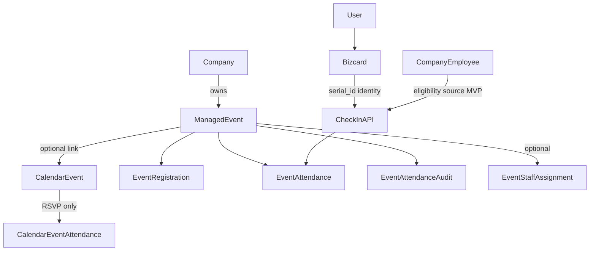

### Portal placement — [PROPOSED]

| Concern | Portal | Rationale |
|---|---|---|
| Create / configure / monitor / export | `/admin/...` under Company | Matches org ownership + existing Company nav |
| Booth check-in UI | Company admin/manager or assigned company employees | Day-of ops belong to the company |
| Platform `/staff` | Only if a new staff module permission is explicitly assigned later | Today’s staff is platform support, not booth staff |
| Member view / RSVP / confirmation | `/user` calendar/events surface | Member journey already lives on user portal |
| SuperAdmin | Oversight / support only | Not day-to-day event ops |

### MVP identity — [PROPOSED]

1. Capture BizCard (or agreed) `serial_id` via NFC URL or QR URL (same backend path).
2. Resolve serial → User server-side (extend/reuse scan-routing patterns).
3. Eligibility via active `CompanyEmployee` for the event’s company **and/or** future Membership API.
4. Write `EventAttendance` with unique `(event_id, user_id)`.

### Design principles

- Backend is authoritative; UI never decides validity alone.
- Do not reuse `CalendarEventAttendance` as venue attendance.
- Prefer append-only corrections over silent overwrite.
- Keep MVP small; mark food/vote/loyalty/network/missions as **[FUTURE PHASE]**.

---

## 7. Event Concept

**[PROPOSED]** A **Managed Event** is an org-operated gathering owned by a `Company`, optionally linked to a personal/company-shared `CalendarEvent` for discovery and reminders.

### Ownership recommendation

| Option | Fit | Decision |
|---|---|---|
| Company-owned | Org monitoring, roster, capacity, booth ops | **Chosen default** |
| User-owned calendar only | Good for RSVP; weak for venue ops | Keep as companion, not primary |
| SuperAdmin-owned | Platform events rare | Oversight only |
| Staff-owned | Staff = platform modules today | Not default |
| Membership-program-owned | Membership **[NOT FOUND]** | Future consumer of eligibility |

### Conceptual fields

| Field | Necessity | Notes |
|---|---|---|
| Event ID | Required | Surrogate key |
| Company ID | Required | Owner |
| Name / description | Required / optional | |
| Starts at / ends at | Required | Drive LIVE/ENDED |
| Location | Recommended | Venue string / address |
| Organizer user ID | Required | Creator / primary admin contact |
| Status | Required | See lifecycle |
| Capacity | Optional | Null = unlimited |
| Registration required | Configurable | Default **open question** |
| Eligibility rules | Required (even if simple) | MVP: company employees |
| Check-in enabled window | Recommended | Opens/closes relative to start |
| Check-out enabled | Optional | **Off by default for MVP** |
| Optional `calendar_event_id` | Optional | Discovery / reminders link |
| Created / updated | Required | Audit hygiene |

Do not implement these fields in this phase — conceptual only.

---

## 8. Event Lifecycle

**[PROPOSED]** Locked lifecycle:

```text
DRAFT → PUBLISHED → LIVE → ENDED → ARCHIVED
                 ↘ CANCELLED
```

| Status | Meaning | Who changes | Trigger | Member visibility | Check-in allowed |
|---|---|---|---|---|---|
| `DRAFT` | Editable, not public | Company admin/manager | Manual save | No (except organizers) | No |
| `PUBLISHED` | Visible; before start | Company admin/manager | Manual publish | Yes (if eligible) | Only if early check-in window configured |
| `LIVE` | Event in progress | System (time) or soft flag | `now ∈ [starts_at, ends_at]` while published | Yes | Yes (if check-in open) |
| `ENDED` | Past end time | System (time) | `now > ends_at` | Yes (read-only) | No (except authorized correction) |
| `ARCHIVED` | Hidden from defaults | Company admin | Manual | No (unless history views) | No |
| `CANCELLED` | Called off | Company admin | Manual | Yes with cancelled state | No |

Notes:

- Prefer **time-derived** LIVE/ENDED rather than requiring operators to flip “ongoing”.
- Stored status should still support explicit `CANCELLED` / `ARCHIVED` / `DRAFT` / `PUBLISHED`.
- Naming: prefer `LIVE` / `ENDED` over `ONGOING` / `UPCOMING` to avoid duplicating time windows already implied by `starts_at`.

---

## 9. Event Creation Flow

**[PROPOSED]**

```text
Company Admin/Manager
      ↓
Create Managed Event
      ↓
Enter information (name, time, place, capacity…)
      ↓
Configure attendance (check-in window, registration required, check-out off)
      ↓
Configure eligibility (MVP: active CompanyEmployee)
      ↓
Save DRAFT
      ↓
Publish → PUBLISHED
      ↓
Members can discover / register (if required)
```

| Action | Who (MVP) |
|---|---|
| Create / edit draft | Company admin (`CompanyEmployee.role=admin`) or designated manager |
| Publish / cancel / archive | Same |
| Monitor / export | Same (+ assigned booth operators read/check-in) |
| Modify attendance records | Authorized company admins; audited |
| SuperAdmin | Support/oversight only — not default creator |
| Platform staff | Not default; future module permission if needed |

Nav placement: nest under **Company** in `/admin` (e.g. Company → Events), not a random new top-level item without product reason.

---

## 10. Member Event Experience

**[PROPOSED]** UX (document only; no UI build):

```text
User
 ↓
Views Event (user portal / linked calendar)
 ↓
Event details
 ↓
Eligible?
 ↓
Register / RSVP if required
 ↓
Reminder (reuse notification/calendar patterns)
 ↓
Arrives at venue
 ↓
NFC / QR (or staff manual)
 ↓
Server verification
 ↓
Check-in
 ↓
Attendance confirmed
```

Member should see:

- Event name, date/time, location, instructions
- Registration status (if required)
- Attendance / check-in status
- Clear success or rejection reason (already checked in, not eligible, event full, not live, offline)

Surface: user calendar / events area (`/user/calendar` exists today for RSVP). Managed Event detail can sit alongside or deep-link from calendar when linked.

---

## 11. Membership Eligibility

**[PROPOSED]** Eligibility is a **gate**, not attendance itself.

MVP source of truth for “may attend”:

1. Event belongs to Company C.
2. User has active `CompanyEmployee` for C (`is_active=true`), **or**
3. Future: Membership projection/API says active for org rules.

**[NOT FOUND]** first-class Membership model — do not invent parallel membership tables inside attendance.

Rules engine (conceptual):

| Rule | MVP | Later |
|---|---|---|
| Active company employee | Yes | Keep |
| Registered only | Configurable | Keep |
| Invited list | Optional | Yes |
| Membership type / tier | Via Membership API | Yes |
| Guests | Open question | Maybe |
| Public walk-ins | Open question | Maybe |

---

## 12. NFC Attendance Flow

**[VERIFIED]** NFC today = physical URL with serial → server classify/redirect.  
**[PROPOSED]** Attendance reuses serial capture; adds an authoritative check-in API.

```text
MEMBER NFC
    ↓
Read serial / membership identifier (URL)
    ↓
TAP Check-in API (event context + serial)
    ↓
Validate member (serial → user)
    ↓
Validate eligibility (company / membership)
    ↓
Validate event (exists, LIVE/check-in window)
    ↓
Check existing attendance
    ↓
Record attendance OR return ALREADY_CHECKED_IN / REJECT
    ↓
Return result to booth/member UI
```

Backend must validate at least:

- Authenticated/authorized operator **or** trusted booth session model (product choice)
- Serial resolves to an active user/BizCard
- Identity belongs to that member (no client-supplied user_id without proof)
- Event exists and accepts check-ins
- Member eligible
- Not a conflicting duplicate (idempotent success if already checked in)
- Optional capacity not exceeded

Frontend must **not** decide validity.

---

## 13. QR Attendance Flow

**[PROPOSED]** QR is an alternative capture channel for the **same** verification service.

| Aspect | NFC | QR |
|---|---|---|
| Capture | Tap physical card/tag | Camera / phone opens QR URL or booth scans member QR |
| Payload | Serial URL | Same serial / portfolio URL or signed check-in token |
| Backend | Shared CheckIn service | Shared CheckIn service |
| Differences | UX / hardware only | UX / hardware only |

**[NOT FOUND]** in-app booth scanner today — MVP may use:

- Member presents portfolio QR; operator submits serial to check-in API, or
- Event station opens member URL / typed serial.

Prefer **one** `verifyAndCheckIn({ eventId, serialOrToken, method, operatorId })` service.

---

## 14. Check-in

**[PROPOSED]** Detailed flow:

```text
Member arrives
      ↓
NFC / QR / manual
      ↓
Identify member + event
      ↓
Validate eligibility + event window
      ↓
Already checked in?
   ├── yes → return ALREADY_CHECKED_IN (idempotent)
   └── no → capacity OK?
              ├── no → EVENT_FULL (unless override)
              └── yes → CHECKED_IN
```

Justified attendance fields:

| Field | Why |
|---|---|
| `event_id`, `user_id` | Who attended what |
| `status` | Lifecycle |
| `checked_in_at` | Timestamp |
| `method` | `nfc` \| `qr` \| `manual` |
| `checked_in_by` | Operator for manual / booth |
| `device_meta` (optional JSON) | Soft forensics (UA/IP) — careful with PII |
| `registration_id` (optional) | Link if registration required |

Do not store redundant denormalized membership snapshots unless reporting needs a point-in-time proof (then store eligibility snapshot explicitly).

---

## 15. Duplicate Check-in Prevention

**Critical business rule — [PROPOSED]**

| Scan | Result |
|---|---|
| First | `CHECK-IN SUCCESS` → one row |
| Second | `ALREADY CHECKED IN` → **no second row** |

Enforcement:

1. Database: `@@unique([event_id, user_id])` on `EventAttendance`.
2. Application: upsert / find-first then insert; catch unique violation → map to idempotent success.
3. Response: return existing record + `duplicate: true` rather than 500.

Do not rely on UI disabling alone.

---

## 16. Check-out

**[PROPOSED] Recommendation:** Event-configurable; **off by default for MVP**.

| Option | Pros | Cons |
|---|---|---|
| Required check-out | Session duration analytics | Friction; incomplete data if people leave without scan |
| Optional / configurable | Flexibility for long events | Extra product surface |
| Not in MVP | Simplest accurate “was present” | No dwell-time metrics |

If enabled later: `CHECKED_IN → CHECKED_OUT` with `checked_out_at`; duplicate check-out idempotent.

---

## 17. Attendance Status

**[PROPOSED]** Keep venue attendance separate from `CalendarEventAttendance.going`.

| Status | Meaning | Trigger | Manual correction? |
|---|---|---|---|
| `REGISTERED` | Signed up (if required) | Registration API | Yes (cancel registration) |
| `CHECKED_IN` | Physically present | Check-in API | Via audit correction |
| `CHECKED_OUT` | Left (if enabled) | Check-out API | Via audit |
| `NO_SHOW` | Registered but never checked in (post-event) | Cron / report job | Yes |
| `VOIDED` | Invalidated record | Correction flow | Creates audit; prefer void over delete |

Avoid overloading calendar `going` / inventing `ABSENT` as a live mutable state without clear semantics — use `NO_SHOW` after event end for registrants who never checked in.

History: maintain `EventAttendanceAudit` append log for status transitions.

---

## 18. Event Monitoring

**[PROPOSED]** Company Admin monitor view (under Company → Event):

Suggested metrics:

- Total registered
- Total checked in
- Not checked in (registered − checked in)
- Attendance rate
- Capacity remaining
- Event status
- Recent check-ins feed
- Last check-in time

**Placement:** Company Admin portal — not SuperAdmin day-to-day, not a new global sidebar without nesting under Company.

**[EXISTING]** Calendar pages show RSVP lists only — insufficient for venue monitoring.

---

## 19. Staff Responsibilities

### Platform Staff — [EXISTING]

- Module CRUD permissions (`staff-mgmt.service.ts`).
- Clients, orders, inquiries, etc.
- **Not** company event booth operators today.

### Company booth operators — [PROPOSED]

| Capability | MVP |
|---|---|
| View assigned events | Yes |
| Monitor attendance | Yes |
| Perform NFC/QR check-in | Yes |
| Search member / manual check-in | Yes (authorized) |
| Correct attendance | Company admin (narrower than all booth staff) |
| Handle invalid scans | Yes (surface API errors) |

Optional later: `EventStaffAssignment` + platform `/staff` module key if TAP Staff must run client events.

---

## 20. Manual Attendance

**[PROPOSED]** Needed when cards fail, phones die, or NFC/QR unreadable.

```text
Member cannot scan
      ↓
Authorized operator searches member
      ↓
Verify identity out-of-band
      ↓
Same eligibility + capacity checks
      ↓
Manual check-in (method=manual)
      ↓
Audit log (operator, reason, timestamp)
```

Abuse controls: permission gate, rate limit, mandatory reason, audit append, no bypass of eligibility unless explicit admin override (also audited).

---

## 21. Attendance Correction

**[PROPOSED]** Prefer **audit-friendly** approaches:

| Situation | Approach |
|---|---|
| Duplicate / erroneous check-in | `VOIDED` + audit; optional recreate |
| Wrong member | Void wrong; check-in correct |
| Wrong event | Void; check-in on correct event |
| Staff mistake | Correction with reason + operator id |
| Silent field overwrite | **Avoid** |

Do not hard-delete historical attendance in MVP reporting windows.

---

## 22. Offline / Network Failure

**[NOT FOUND]** offline attendance sync infrastructure.

| Option | Security | MVP? |
|---|---|---|
| A. Reject / require online | Safest; no forged queues | **Recommended** |
| B. Controlled offline store | Risk of replay, eligibility drift | Future |
| C. Queue + sync later | Needs signed offline tokens, conflict rules | Future |

**Recommendation:** MVP **reject** with clear “No connection — try again” UI. Queued sync is **[FUTURE PHASE]**.

---

## 23. Capacity Management

**[PROPOSED]**

- Optional `capacity` on Managed Event.
- Check-in path: if `checked_in_count >= capacity` → `EVENT_FULL`.
- Registration can optionally soft-cap separately from check-in hard-cap (product choice).
- Staff override: company admin only, audited.
- Walk-ins: only if eligibility allows and capacity remains.

Registered-member priority vs walk-ins: **open question** (see §37).

---

## 24. Event Eligibility

**[PROPOSED]** Who may attend (config matrix):

| Audience | MVP default |
|---|---|
| Active company employees | Yes |
| Specific membership types | When Membership API exists |
| Registered only | Configurable |
| Invited only | Optional |
| Guests / public | Open question — off until decided |
| Staff operators | Check-in privilege ≠ attendee |

Consume membership status through a single eligibility service:

```text
eligibilityService.canAttend(event, user) → { ok, reason }
```

No duplicated “is member?” logic inside random UI components.

---

## 25. Membership + Attendance Relationship

```text
MEMBERSHIP / COMPANY EMPLOYEE
    ↓
determines eligibility

MANAGED EVENT
    ↓
defines attendance opportunity

ATTENDANCE
    ↓
records actual participation
```

| Concept | Answers |
|---|---|
| Membership / employee seat | “May this person attend?” |
| Registration / RSVP | “Do they intend to attend?” |
| Attendance | “Did they show up (and when)?” |

**Membership ≠ Attendance.** Never mark someone checked-in solely because they are a member or RSVP’d `going`.
---
## 26. Database / Data Model Proposal
### Reusable today — [VERIFIED]

| Model | Reuse as |
|---|---|
| `Company` / `CompanyEmployee` | Owner + MVP eligibility |
| `User` / `Bizcard.serial_id` | Identity |
| `CalendarEvent` / `CalendarEventAttendance` | Optional discovery + RSVP only |
| `CompanyAuditLog` | Pattern for org actions (or parallel event audit) |
| `WebhookEvent` pattern | Inspiration for idempotency — not storage |

### Conceptual new entities — [PROPOSED] (do not create in this phase)

#### `ManagedEvent`

- Purpose: company-owned venue event.
- Key fields: company_id, title, description, starts_at, ends_at, place, status, capacity, registration_required, check_in_opens_at/closes_at, check_out_enabled, optional calendar_event_id, created_by.
- Why new: `CalendarEvent` is user-owned RSVP/appointment shaped; org ops need different lifecycle and permissions.

#### `EventRegistration`

- Purpose: RSVP/registration for managed events when required.
- Why not only `CalendarEventAttendance`: different owner domain and statuses; optional sync/link later.

#### `EventAttendance`

- Purpose: physical presence record.
- Key fields: event_id, user_id, status, checked_in_at, checked_out_at?, method, checked_in_by?, device_meta?
- Constraint: `@@unique([event_id, user_id])`.
- Why not reuse calendar attendance: RSVP ≠ venue presence.

#### `EventAttendanceAudit`

- Purpose: append-only corrections and manual actions.
- Fields: attendance_id, actor_user_id, action, before/after JSON, reason, created_at.

#### `EventStaffAssignment` (optional)

- Purpose: booth operators who are not company admins.
- Defer if MVP limits operators to company admins.

**Do not** implement Prisma models in this phase.

---

## 27. API Integration Proposal

**[VERIFIED]** Convention: Next.js route handlers under `app/api/**`, services in `lib/services/**`, cookie session auth.

**[PROPOSED]** Conceptual endpoints (names illustrative; follow existing kebab/rest style when implementing):

| Endpoint concept | Purpose | AuthZ |
|---|---|---|
| `POST /api/company/events` | Create draft | Company admin |
| `GET /api/company/events` | List company events | Company admin / assigned |
| `GET /api/company/events/[eventId]` | Detail | Admin or eligible member (scoped fields) |
| `PATCH /api/company/events/[eventId]` | Edit / publish / cancel | Company admin |
| `POST /api/company/events/[eventId]/register` | Registration | Authenticated eligible user |
| `POST /api/company/events/[eventId]/check-in` | Authoritative check-in | Booth operator / admin |
| `POST /api/company/events/[eventId]/check-out` | Optional check-out | Same |
| `POST /api/company/events/[eventId]/check-in/manual` | Manual | Admin / authorized |
| `POST /api/company/events/[eventId]/attendance/correct` | Void/correct | Admin |
| `GET /api/company/events/[eventId]/monitor` | Counts + recent | Admin / assigned |
| `GET /api/company/events/[eventId]/attendance/export` | CSV/report | Admin |
| `GET /api/user/events...` | Member list/detail/status | Self |

For each (conceptual):

- **Request:** event id, serial/token or user id (manual), optional idempotency key, reason for manual/correct.
- **Response:** status, attendance record, flags (`duplicate`, `capacity_full`), human-readable message.
- **AuthN:** existing session cookies.
- **AuthZ:** company membership role / assignment.
- **Validation:** zod/schema patterns already used in APIs.
- **Errors:** structured codes (`NOT_ELIGIBLE`, `EVENT_NOT_LIVE`, `ALREADY_CHECKED_IN`, `EVENT_FULL`, `OFFLINE_REQUIRED` N/A server-side).

**Do not implement APIs in this phase.**

Optional: thin public/booth path that resolves serial then calls the same service — never fork business rules.

---

## 28. Idempotency

**[PROPOSED]**

Scenarios: double NFC tap, flaky retry, double-submit UI.

Approach:

1. Natural key uniqueness `(event_id, user_id)`.
2. Optional client `Idempotency-Key` for a single tap attempt (store short-lived result) — pattern inspired by `lib/webhook-idempotency.ts`, **not** `WebhookEvent` table.
3. Safe retries return the same attendance payload with `duplicate: true`.

---

## 29. Security

**[PROPOSED]** requirements (backend authoritative):

| Area | Guidance |
|---|---|
| Authentication | Existing DB session cookies |
| Authorization | Company role / event assignment |
| Member identity | Resolve serial server-side; do not trust client user_id alone for NFC/QR |
| Eligibility | Server eligibility service |
| Token validation | Prefer signed short-lived tokens if exposing public check-in URLs |
| Replay | Idempotent check-in; optional token expiry |
| Duplicates | Unique constraint |
| Rate limiting | Reuse `server/lib/rate-limit.ts` patterns on check-in |
| Audit | Manual + corrections mandatory |
| PII | Minimize device_meta; export ACLs strict |
| Offline | Reject in MVP |

---

## 30. Audit Logging

**[PROPOSED]** Auditable actions:

- Event created / edited / published / cancelled / archived
- Registration create / cancel
- Check-in / check-out (especially manual)
- Attendance void / correct
- Capacity override
- Staff/operator privileged actions

Retain: actor, company, event, target user, action, reason, before/after, request id, timestamp, IP/UA when appropriate.

Reuse conceptual shape of `CompanyAuditLog` and/or dedicated `EventAttendanceAudit`.

---

## 31. Reporting

| Report | Phase |
|---|---|
| Total attendees / checked-in count | MVP |
| Attendance rate vs registered | MVP |
| CSV export (name, email, time, method) | MVP |
| No-shows | MVP (post-event) |
| Check-in time distribution | Future |
| Member attendance history across events | Future |
| Operator activity | Future |

---

## 32. User Experience

Principles: fast, simple, mobile-friendly, clear, minimal taps, error-resistant.

Successful scan example:

```text
Attendance Confirmed

Juan Dela Cruz
Annual Business Summit
Checked in at 8:42 AM
```

Failure examples should state **one** clear reason: Already checked in / Not eligible / Event full / Event not open / No connection.

Booth UI: large status color, member name, undo only via authorized correction (not casual undo).

---

## 33. Business Benefits

Grounded in TAP’s existing identity + company tooling:

- Faster door check-in vs paper lists
- Less manual roster work
- Higher accuracy than honor-system RSVP
- Duplicate prevention via unique constraints
- Centralized member identity (BizCard serial)
- NFC/QR convenience already in members’ hands
- Near-real-time operational visibility (polling)
- Exportable evidence of attendance
- Foundation for food tokens, voting eligibility, loyalty points, event networking, mission progress **[FUTURE PHASE]**

---

## 34. Future Integration

All items below are **[FUTURE PHASE]** — extension points only.

### A. Food / Token Claiming

```text
Check-in successful → eligible for food token batch → token becomes available
```

### B. Voting

```text
Verified attendance / member identity → eligible to cast ballot
```

### C. Loyalty

```text
Attendance → loyalty activity → points ledger
```

### D. Networking

```text
Checked-in members → event directory / discover people here
```

### E. Mission / Rewards

```text
Attend event → mission progress → reward eligibility
```

Attendance service should emit a stable domain event / hook (`attendance.checked_in`) for these consumers later — do not build them now.

---

## 35. Complete Flowcharts

### 35.1 Overall Attendance Architecture

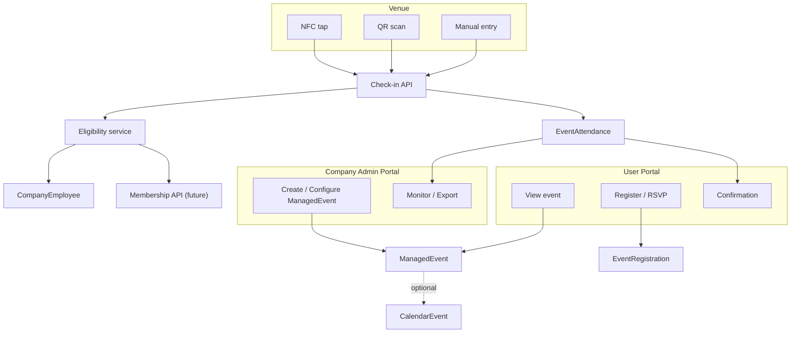

### 35.2 Event Creation Flow

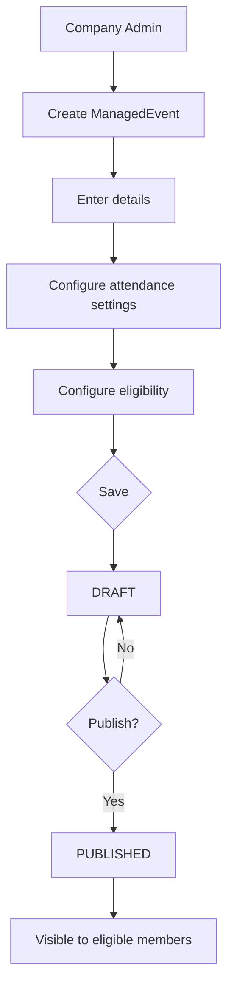

### 35.3 Member Event Journey

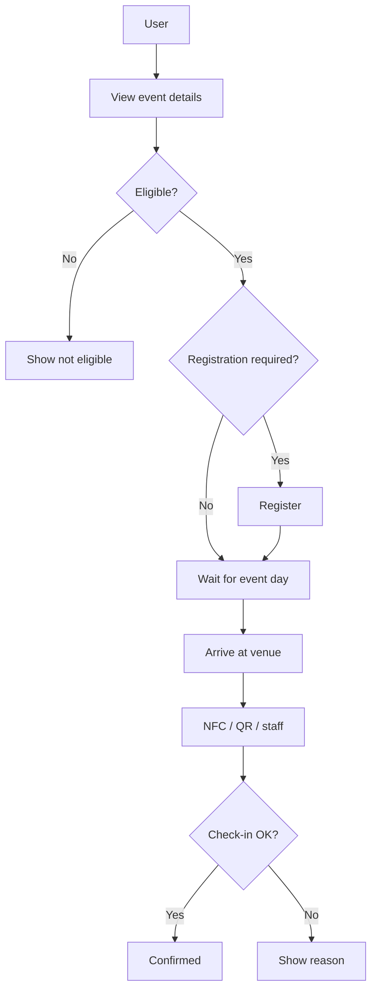

### 35.4 NFC Check-in Flow

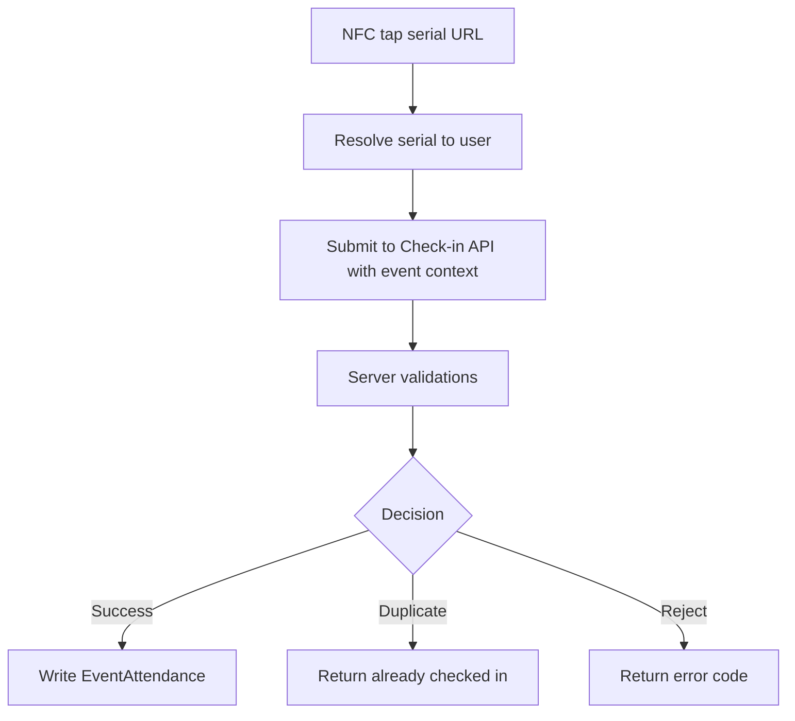

### 35.5 QR Check-in Flow

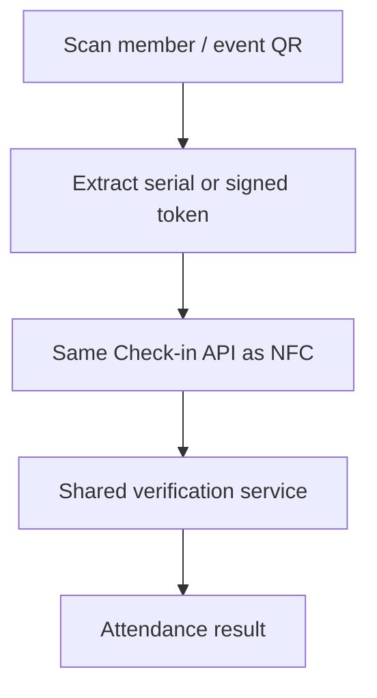

### 35.6 Attendance Validation Flow

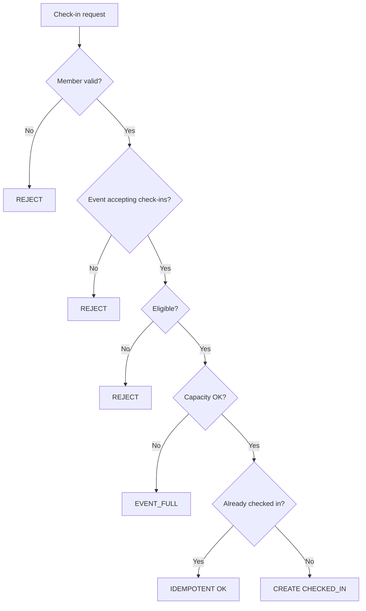

### 35.7 Duplicate Check-in Flow

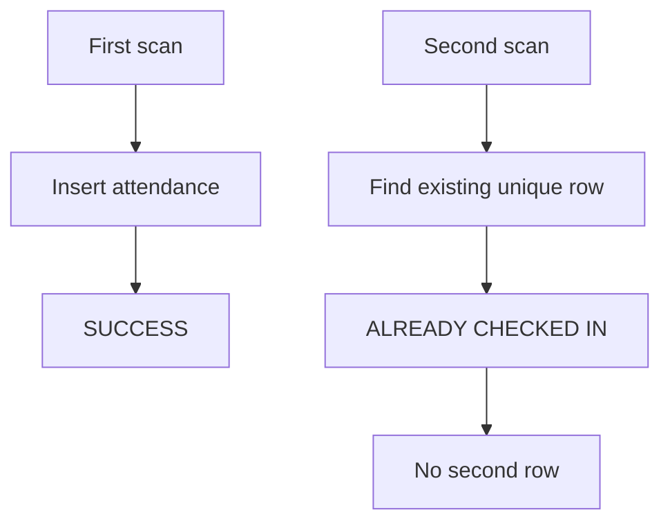

### 35.8 Check-out Flow

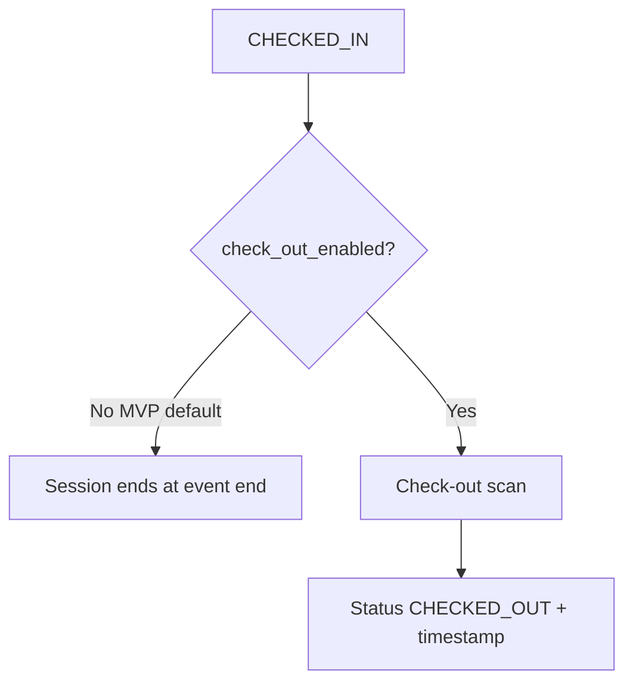

### 35.9 Manual Attendance Flow

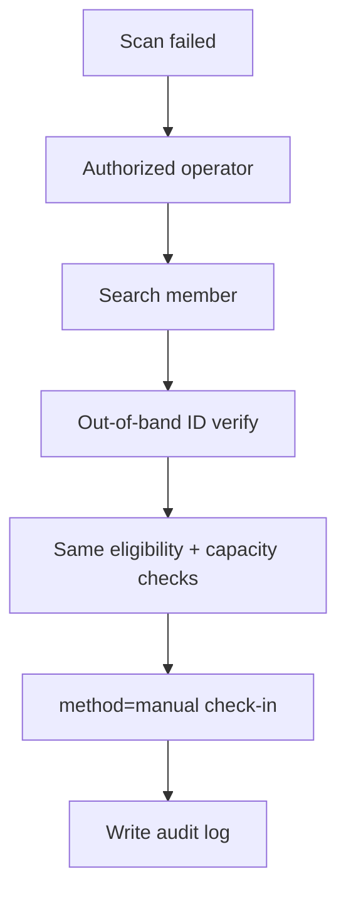

### 35.10 Attendance Monitoring Flow

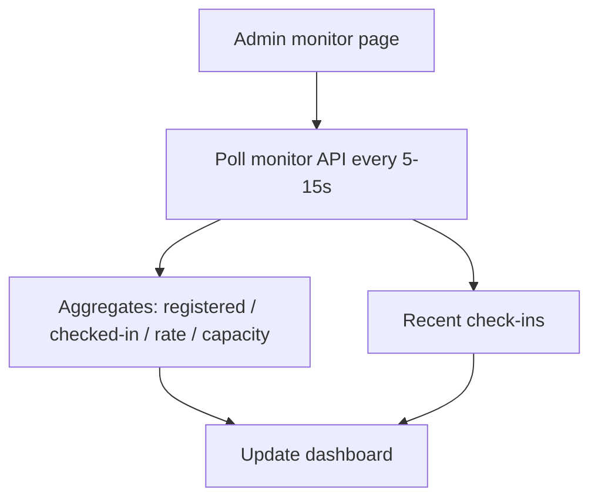

### 35.11 Membership + Event Eligibility Flow

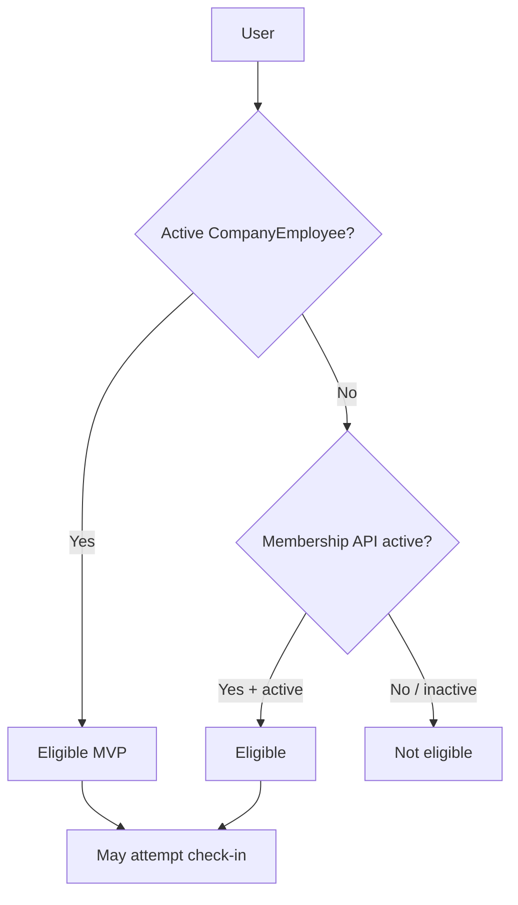

### 35.12 Failure / Network Error Flow

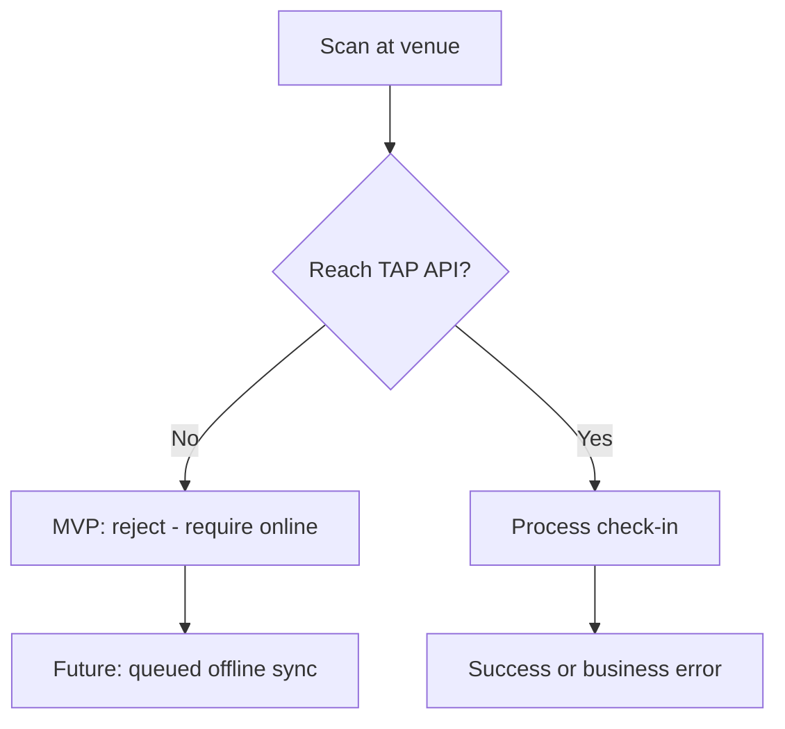

### 35.13 Future Food Token Integration

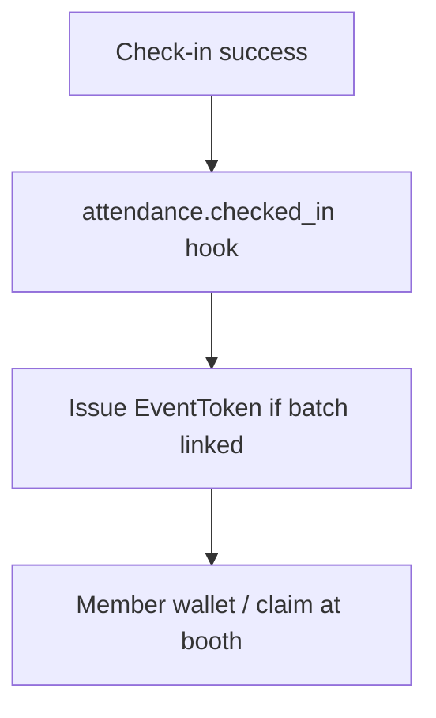

### 35.14 Future Voting Integration

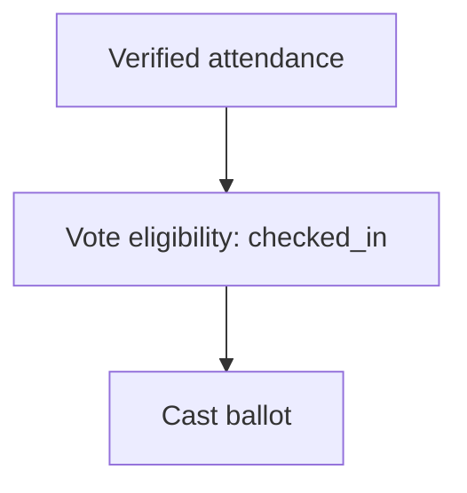

### 35.15 Future Loyalty Integration

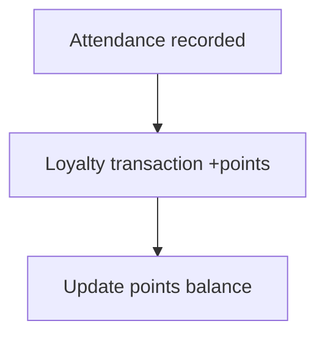

### 35.16 Future Networking Integration

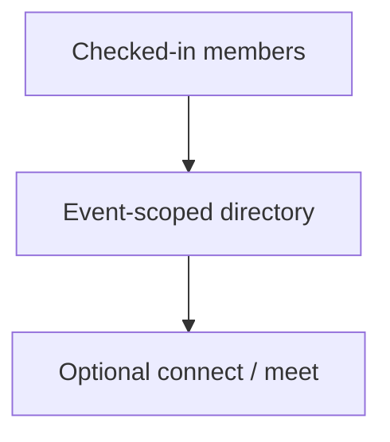

### 35.17 Complete End-to-End Flow

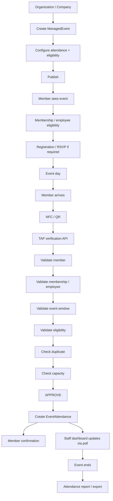

Narrative (adapted to TAP):

Organization (Company) creates and publishes a Managed Event → eligible members discover it (user portal; optional CalendarEvent link) → register if required → on event day NFC/QR serial is captured → Check-in API validates member, eligibility, event window, duplicates, capacity → writes one attendance row → member sees confirmation → admin monitor polls updates → after end, export/no-show reporting.

---

## 36. Files / Modules Potentially Affected

### VERIFIED EXISTING FILES

| Area | Existing File/Module | Current Responsibility | Potential Impact | Reason |
|------|----------------------|------------------------|------------------|--------|
| Auth | `server/lib/auth.ts` | DB sessions / cookies | Low (reuse) | Check-in/admin APIs use existing sessions |
| Proxy | `proxy.ts` | CSRF/CSP/CORS | Low | New routes inherit existing guards |
| Portal nav | `app/config/portalNavigation.ts` | Portal sidebars | Medium (future) | Nest Events under Company admin |
| Company schema | `prisma/schema.prisma` (`Company`, `CompanyEmployee`, `CompanyAuditLog`) | Org roster + audit | Medium (future relations) | Ownership + eligibility + audit patterns |
| BizCard / serial | `prisma/schema.prisma` (`Bizcard`), `lib/services/serialIdService.ts` | Physical IDs | Low–Medium | Identity resolve for check-in |
| Scan routing | `lib/bizcard/scan-routing.ts` | Serial URL classify/redirect | Medium | Possible event check-in branch / reuse resolve helpers |
| Public scan API | `app/api/public/scan/[serialId]` (and related) | NFC/QR entry | Medium | May deep-link into check-in context |
| Calendar | `lib/services/calendar-event.service.ts`, `app/api/calendar/**` | RSVP appointments | Low–Medium | Optional link; do not overload as venue attendance |
| Calendar UI | `app/user/calendar/page.tsx`, `app/admin/calendar/page.tsx`, … | Calendar UX | Medium | Member discovery / reminders surface |
| Notifications | `server/lib/notifications.ts`, calendar reminder cron | Reminders | Medium | Event reminders for managed events |
| Idempotency pattern | `lib/webhook-idempotency.ts` | Webhook once-only | Conceptual only | Pattern reuse, not table reuse |
| Staff perms | `lib/services/staff-mgmt.service.ts` | Platform staff modules | Low unless product requires | New module key only if platform staff run booths |
| Rate limit | `server/lib/rate-limit.ts` | API throttling | Low–Medium | Protect check-in endpoints |
| Feature doc | `docs/FEATURE_INTEGRATION_RECOMMENDATIONS.md` | Prior §5.2 proposal | Docs only | Ownership model differs (documented here) |

### POTENTIALLY AFFECTED FILES

*(Only if/when implementation is approved — evidence-based candidates)*

| Area | Existing File/Module | Current Responsibility | Potential Impact | Reason |
|------|----------------------|------------------------|------------------|--------|
| Schema | `prisma/schema.prisma` | Data model | High | New Managed Event entities |
| Admin company UI | `app/admin/company/**` | Company management | High | Natural home for event CRUD/monitor |
| User portal | `app/user/**` | Member UX | Medium | Event list / confirmation |
| Employee cards | `lib/services/*EmployeeCard*` / `/api/cards/*` | Company NFC cards | Low–Medium | Alternate identity media — product choice |
| Notification templates | `server/lib/notification-templates.ts` | Email/in-app copy | Medium | Event publish / reminder / check-in notices |

### POSSIBLE NEW FILES FOR FUTURE IMPLEMENTATION

| Area | Possible new module | Responsibility |
|------|---------------------|----------------|
| Service | `lib/services/managed-event.service.ts` | CRUD + lifecycle |
| Service | `lib/services/event-attendance.service.ts` | Check-in / out / correct / idempotency |
| Service | `lib/services/event-eligibility.service.ts` | Employee + future Membership gates |
| API | `app/api/company/events/**` | Admin/member event APIs |
| UI | `app/admin/company/events/**` | Create / monitor / scanner |
| UI | `app/user/events/**` or calendar extensions | Member journey |
| Docs | this file | Architecture source of truth for the feature |

**This discovery phase does not modify any of the above application files.**

---

## 37. Open Questions

Do **not** guess; resolve with stakeholders before build:

1. **Registration default:** Is registration required by default, or check-in-only for eligible employees?
2. **Guests:** Are non-employee / non-member guests supported in MVP?
3. **Personal hosts:** Can individual users create Managed Events, or company-only?
4. **Membership timing:** Block on Membership SoT API, or ship MVP on `CompanyEmployee` only?
5. **EmployeeCard vs BizCard:** Which serial is canonical at the door when both exist?
6. **Booth auth model:** Logged-in company admin device vs shared booth PIN/session?
7. **Registered priority:** When capacity is tight, do registrants beat walk-ins?
8. **Platform staff:** Must `/staff` ever run check-in for client companies in MVP?
9. **Calendar linkage:** Auto-create linked `CalendarEvent` on publish, or optional manual link?
10. **Early check-in:** How long before `starts_at` may check-in open?
11. **Public events:** Can Managed Events be discoverable outside the company?
12. **Correction SLA:** Who may void attendance — all booth ops or admins only?

---

## 38. Recommended Implementation Phases

### Phase 0 — Decisions (this doc + stakeholder answers)

- Lock ownership (Company), lifecycle, offline reject, check-out off, eligibility MVP source.

### Phase 1 — MVP (venue attendance)

1. Schema: `ManagedEvent`, `EventRegistration` (if required), `EventAttendance`, `EventAttendanceAudit`.
2. Services: eligibility (CompanyEmployee), check-in idempotent, monitor aggregates, export CSV.
3. Admin UI: create/publish/monitor/manual check-in under Company.
4. Member UI: view + status (+ register if required).
5. Reuse serial resolve; short polling monitor; online-only.

### Phase 2 — Hardening

- EventStaffAssignment, capacity overrides UX, richer audits, reminder crons, signed tokens, rate limits tuned for door volume.

### Phase 3 — Membership consumption

- Swap/extend eligibility to Membership API without rewriting attendance.

### Phase 4 — Future products — [FUTURE PHASE]

- Food tokens, voting, loyalty, networking, missions via `attendance.checked_in` hooks.
- Optional offline queued sync if product demands it.
- Optional realtime push if polling is insufficient.

Avoid rewrites: keep calendar RSVP intact; keep one check-in service; do not duplicate identity.

---

## 39. Final Architecture Recommendation

1. **Build a Company-owned Managed Event domain** for Attendance & Event Monitoring — do not force venue ops into user-owned `CalendarEventAttendance`.
2. **Keep calendar RSVP** for intent/reminders; optionally link for discovery.
3. **Reuse BizCard serial NFC/QR paths** and a **single server check-in service** for both channels.
4. **MVP eligibility = active `CompanyEmployee`**, with a clean seam for future Membership SoT.
5. **Enforce uniqueness** `(event_id, user_id)` + idempotent responses; audit manual/corrections.
6. **Check-out off by default**; **offline reject** until sync infra exists.
7. **Monitor in Company Admin** with short polling; platform Staff/SuperAdmin are not the default operators.
8. **Ship phased**: MVP attendance → membership gate → future food/vote/loyalty/network/missions.

**Status:** Discovery complete. **No application code, schema, APIs, UI, packages, env, or migrations were changed** in producing this document.

---

*End of document.*

---

## Whole Flow — Attendance & Event Monitoring

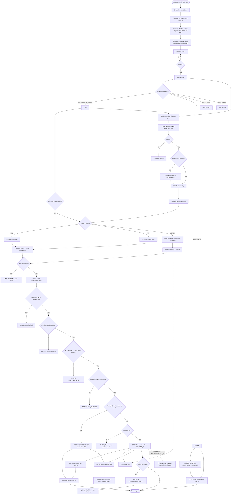
