# TAP — Voting System & Loyalty Card

**Document version:** 1.0  
**Date:** September 5, 2026  
**Status:** Discovery / architecture only — **no implementation in this phase**  
**Scope:** `ontapnewsystem` (TAP portal)  
**Related:**
- [`docs/FEATURE_INTEGRATION_RECOMMENDATIONS.md`](FEATURE_INTEGRATION_RECOMMENDATIONS.md) §5.4 (prior proposal; this document refines ownership, election-grade voting, and ledger loyalty)
- [`docs/Attendance & Event Monitoring.md`](Attendance%20%26%20Event%20Monitoring.md) (Managed Events / attendance consumption)

---

## Table of Contents

1. [Executive Summary](#1-executive-summary)
2. [Existing TAP Architecture](#2-existing-tap-architecture)
3. [Verified Existing Systems](#3-verified-existing-systems)
4. [Proposed Architecture](#4-proposed-architecture)
5. [Core System Principles](#5-core-system-principles)
6. [Voting System](#6-voting-system)
7. [Loyalty Card](#7-loyalty-card)
8. [System Integration](#8-system-integration)
9. [Roles & Permissions](#9-roles--permissions)
10. [Conceptual Data Model](#10-conceptual-data-model)
11. [API Architecture](#11-api-architecture)
12. [Security & Fraud Prevention](#12-security--fraud-prevention)
13. [Idempotency & Concurrency](#13-idempotency--concurrency)
14. [Offline / Network Failure](#14-offline--network-failure)
15. [Reporting](#15-reporting)
16. [UX Architecture](#16-ux-architecture)
17. [Business Value](#17-business-value)
18. [Future Expansion](#18-future-expansion)
19. [MVP vs Future](#19-mvp-vs-future)
20. [Mermaid Flowcharts](#20-mermaid-flowcharts)
21. [File Impact Report](#21-file-impact-report)
22. [Recommended Implementation Order](#22-recommended-implementation-order)
23. [Testing Strategy](#23-testing-strategy)
24. [Open Business Questions](#24-open-business-questions)
25. [Final Architecture Recommendation](#25-final-architecture-recommendation)

---

## Label legend

| Label | Meaning |
|---|---|
| **[VERIFIED EXISTING]** | Confirmed directly from the current codebase |
| **[PROPOSED]** | Recommended future architecture (not implemented) |
| **[NOT FOUND]** | Could not be verified in the current codebase |
| **[SHARED]** | Existing entity reused conceptually by Voting/Loyalty |
| **[FUTURE PHASE]** | Explicitly deferred; extension point only |
| **[ASSUMED]** | Explicit assumption (called out only when necessary) |

---

## 1. Executive Summary

**[PROPOSED]** TAP should gain two **company-owned** modules that share identity and verification — not a single “points + poll” feature:

| Module | Purpose | What it is not |
|---|---|---|
| **Voting System** | Controlled organizational elections/polls with eligibility, lifecycle, one-person-one-vote, optional confidentiality, audit, and published results | A naive “question + choices + submit” widget |
| **Loyalty Card** | Engagement credential using the same NFC/QR member identity, with a **transaction ledger**, configurable earn/redeem rules, and staff claim | A second identity card, or a blind `points` integer on `User` |

**[VERIFIED EXISTING]** TAP already provides User sessions, Company RBAC, BizCard serial NFC/QR resolve, Growth Missions/Rewards (referral), calendar RSVP, and audit patterns.

**[NOT FOUND]** Election/ballot models; org loyalty ledger; first-class Membership; Managed Event attendance implementation (docs only).

**Locked defaults (this discovery):**

- Company owns Elections and Loyalty Programs; SuperAdmin oversight; Staff assist only with permissions.
- NFC/QR = identity credential only; server decides eligibility, votes, and points.
- Confidential elections use participation + anonymous ballot separation (confidentiality, not perfect anonymity).
- Voting does **not** earn loyalty points by default (Policy A).
- Growth Missions / `spin_balance` stay **separate** from org Loyalty.
- Loyalty **consumes** Attendance when implemented; does not duplicate check-in.

---

## 2. Existing TAP Architecture

### 2.1 Stack — [VERIFIED EXISTING]

| Layer | Technology / location |
|---|---|
| Frontend | Next.js App Router under `app/` |
| Backend | Route handlers `app/api/**`; services `lib/services/**`, `server/lib/**` |
| Database | MySQL via Prisma (`prisma/schema.prisma`) |
| Auth | Opaque DB sessions + httpOnly cookies (`server/lib/auth.ts`) |
| Edge | `proxy.ts` — CSRF / CSP / CORS |
| Root JWT middleware | **[NOT FOUND]** (no root `middleware.ts`) |

### 2.2 Portals — [VERIFIED EXISTING]

From `app/config/portalNavigation.ts`:

| Portal | Path | Relevant today |
|---|---|---|
| User | `/user/*` | Dashboard, BizCards, Associate, E-market, Growth → Missions, Settings |
| Company Admin | `/admin/*` | Company, BizCards, Associate, E-market |
| Staff | `/staff/*` | Clients, orders, inquiries, messages (module CRUD) |
| SuperAdmin | `/superadmin/*` | Users, companies, Missions & Rewards, promos, subscriptions |
| Dev | `/dev/*` | Ops / health |

### 2.3 Roles — [VERIFIED EXISTING]

- Platform: user / admin / super_admin / staff (portal guards in `lib/auth/*`).
- Company: `CompanyEmployee.role` ∈ `admin` \| `manager` \| `employee` \| `viewer` (`server/lib/company.ts`).
- Staff modules: DB-driven `StaffModule` + CRUD perms (`lib/services/staff-mgmt.service.ts`).

---

## 3. Verified Existing Systems

### 3.1 Authentication — [VERIFIED EXISTING]

Login / registration / session create-validate-revoke / cookies / WebAuthn patterns live in `server/lib/auth.ts` and related auth APIs. Authorization is portal + company role + staff module based.

### 3.2 Membership — [NOT FOUND] as first-class domain

| Concept | Status |
|---|---|
| `Membership` / renewals SoT model | **[NOT FOUND]** in Prisma |
| Company “membership” | Employee seat via `CompanyEmployee` (`is_active`, role) |
| BizCard subscription | Product/platform tier (`Bizcard` / `BizcardSubscription`) — not org membership |
| NFC/QR membership ID | Effectively BizCard / EmployeeCard `serial_id` |

**[PROPOSED]** Treat future Membership API as eligibility SoT when available. MVP eligibility = active `CompanyEmployee` for the owning company (same stance as Attendance doc).

### 3.3 Attendance — docs only

| Item | Status |
|---|---|
| [`docs/Attendance & Event Monitoring.md`](Attendance%20%26%20Event%20Monitoring.md) | **[VERIFIED EXISTING]** discovery doc |
| `ManagedEvent` / `EventAttendance` | **[NOT FOUND]** in Prisma |
| Calendar RSVP | **[VERIFIED EXISTING]** `CalendarEvent` + `CalendarEventAttendance` |

Loyalty and event-scoped voting must **consume** attendance records when they exist — never re-implement check-in inside Loyalty/Voting.

### 3.4 NFC / QR — [VERIFIED EXISTING]

- Resolve: `lib/bizcard/scan-routing.ts`, `app/api/public/scan/[serialId]`, `app/api/bizcard/scan/[serialId]`, company cards via `app/api/cards/scan`.
- QR generation for portfolio/VCF; camera scan = open URL.
- **[NOT FOUND]** Web NFC API; in-app booth scanner; context-aware “election vs loyalty vs attendance” router (proposed below).

### 3.5 Growth / spin / promos (adjacent, not Loyalty) — [VERIFIED EXISTING]

| System | Role |
|---|---|
| `Mission` / `Reward` / `UserReward` | Referral-growth unlocks (`qualified_referrals`) |
| `server/lib/growth-referral.ts`, `growth-rewards.ts` | Qualify referrals; grant rewards idempotently |
| `User.spin_balance` + roulette | Marketplace spin economy |
| `Promotion` / `PromoUsage` | Discount vouchers |

**Do not** use these as the org Loyalty ledger. Optional FUTURE bridges only.

### 3.6 Voting / org Loyalty — [NOT FOUND]

No `Election`, `Ballot`, `LoyaltyProgram`, `LoyaltyAccount`, or points ledger in schema or APIs.

### 3.7 Prior proposal — [VERIFIED EXISTING]

FEATURE_INTEGRATION §5.4 suggests flat `Vote` + JSON `points_per_action`. This document upgrades to election-grade Voting and ledger Loyalty under **Company** ownership.

### 3.8 Idempotency / audit patterns — [VERIFIED EXISTING]

- `lib/webhook-idempotency.ts` + `WebhookEvent` (pattern reuse, not table reuse).
- `CompanyAuditLog` + `logCompanyAudit` in `server/lib/company.ts`.
- `server/lib/rate-limit.ts` for API throttling.

---

## 4. Proposed Architecture

**[PROPOSED]** Two modules, one verification layer, Company as owner.

```text
Member
  ↓
Membership / CompanyEmployee (eligibility SoT)
  ↓
NFC / QR Member Credential (serial)
  ↓
TAP Verification Layer
  ├── Voting Eligibility → Ballot (governance)
  ├── Attendance (participation record — when implemented)
  └── Loyalty Activity → Ledger → Rewards
```

| Concern | Portal home |
|---|---|
| Create/configure elections & loyalty | `/admin` under Company |
| Cast vote / view loyalty | `/user` contextual modules |
| Assist / monitor (limited) | `/staff` only with new module perms |
| Platform oversight | `/superadmin` |

---

## 5. Core System Principles

Documented separation of sources of truth:

| System | Owns |
|---|---|
| **Membership** (future) / **CompanyEmployee** (MVP) | Identity + eligibility |
| **NFC/QR** | Credential / identity verification |
| **Voting** | Governance activity + ballots |
| **Attendance** | Physical participation record |
| **Loyalty** | Engagement ledger + redemptions |
| **Rewards (loyalty)** | Benefits purchased with points |
| **Growth Missions** | Platform referral perks (existing, separate) |

**Why this matters:** Without separation, TAP risks fake “votes” from QR screenshots, points awarded without verified events, ballot leakage into loyalty analytics, and duplicated member identity tables.

**Non-negotiable rules:**

1. Client never decides eligibility, vote validity, or point deltas.
2. NFC tap never auto-casts a vote or auto-awards points without a verified qualifying action.
3. Loyalty never stores a second attendance row; it references attendance/order/referral IDs.
4. Confidential ballots never flow ballot choices into Loyalty or Staff dashboards.

---

## 6. Voting System

### 6.1 Purpose

Allow eligible members of a **Company** (organization) to participate in controlled processes: board/officer elections, resolutions, proposals, event-linked polls where appropriate.

A Voting System must support:

- Voter eligibility
- Election lifecycle
- Ballot configuration
- Voting period
- One-person-one-vote
- Optional confidential/anonymous ballot mode
- Integrity + auditability
- Result calculation and publication
- Election closure

### 6.2 Election Lifecycle

**[PROPOSED]**

```text
DRAFT → SCHEDULED → OPEN → CLOSED → RESULTS_AVAILABLE → ARCHIVED
                              ↘ CANCELLED
```

| Status | Meaning | Accepts votes? | Notes |
|---|---|---|---|
| `DRAFT` | Editable; incomplete OK | No | Cannot skip config |
| `SCHEDULED` | Config complete; before `opens_at` | No | Time or cron → OPEN |
| `OPEN` | Within voting window | Yes | Re-validate eligibility on submit |
| `CLOSED` | Past `closes_at` or forced close | No | Prepare tallies |
| `RESULTS_AVAILABLE` | Results published per visibility policy | No | Immutable tallies preferred |
| `ARCHIVED` | Hidden from defaults | No | Retained for history |
| `CANCELLED` | Voided before/during | No | Audit reason required |

**Invalid transitions (examples):** `DRAFT → OPEN` without options + eligibility; any → accept vote when not `OPEN`; edit options after ballots exist without controlled procedure.

### 6.3 Election Creation

**[PROPOSED]** Company Admin/Manager creates elections.

| Field | MVP configurable? | Notes |
|---|---|---|
| Name, description, instructions | Yes | |
| Company ID | Yes (owner) | Implicit from admin context |
| Type | Yes | `single` \| `yes_no` \| `multi` |
| Opens / closes (+ timezone) | Yes | Store UTC; display local |
| Eligibility rules | Yes | See §6.4 |
| Privacy model | Yes | `identified` \| `confidential` |
| Result visibility | Yes | Default `hidden_until_close` |
| Vote change policy | Optional | Default: final on submit |
| Optional `managed_event_id` | Future | Event-scoped elections |
| Audit settings | Soft | Always audit privileged actions |

### 6.4 Eligibility

**[PROPOSED]** Server function: `canVote(election, user) → { ok, reason }`.

MVP conditions (configurable composition):

- Authenticated session
- Active `CompanyEmployee` for election’s company (or future Membership active)
- Correct org
- Optional membership type / tenure (when Membership exists)
- Optional “must be checked in to event X” (when Attendance exists)
- Not suspended/restricted employee
- Election `OPEN`
- Not already participated (unless change policy allows)

Flow:

```text
Member → Authenticate → Identify → Membership/Employee
  → Validate org → Validate status → Election rules
  → Voting status → Allow / Reject
```

Do **not** hardcode a single rule set in the UI.

### 6.5 NFC Voting

**[PROPOSED]** NFC establishes identity only.

```text
Tap NFC → Resolve serial → Session / verify member
  → Find OPEN election (context or list)
  → Eligibility → Duplicate check
  → Open ballot UI → Select → Review → Confirm
  → Server revalidates → Create participation + ballot
  → Confirmation
```

**Forbidden:** NFC tap → directly cast vote.

Final submission must re-check: session, election OPEN, eligibility, duplicate, option IDs belong to election.

### 6.6 QR Voting

Same backend as NFC; capture channel differs (scan URL / present member QR / booth enters serial).

Differences: UX/hardware only. Shared `submitBallot` service.

### 6.7 Ballot

| Type | MVP | Future |
|---|---|---|
| Single choice | Yes | |
| Yes / No | Yes | |
| Multiple choice (max N) | Yes | |
| Candidate list (as options) | Yes (labels) | Rich candidate profiles |
| Ranked / weighted / STV | No | Future |
| Write-in | No | Future |

### 6.8 Duplicate Prevention

**One person = one vote (per election).**

| Strategy | Use |
|---|---|
| `@@unique([election_id, user_id])` on `VoterParticipation` | Hard stop |
| Idempotency-Key on submit | Network retries |
| Confidential: participation unique; ballot keyed by opaque token | No second ballot |

**Option A — Direct member → vote record:** Simple; org can link choice to member. Fine for identified polls.

**Option B — Participation + anonymous ballot:** Better for confidential elections. **Chosen for confidential mode.**

Default MVP privacy = identified participation with ballot still write-protected (admins don’t casually edit counts).

### 6.9 Confidential Voting

| Mode | What org sees |
|---|---|
| Identified | Who voted (+ optionally choices if policy allows identified tallies) |
| Confidential | Who voted (participation); **not** casual link from choice → member |

Conceptual flow (confidential):

```text
Member Identity → Eligibility → VoterParticipation
  → Issue one-time ballot token (unlinkable)
  → Ballot stored without user_id
  → Tallies from ballots only
```

**Tradeoff:** Operational confidentiality, not cryptographic coercion-resistance or perfect anonymity (DB admins with raw access are a residual risk unless further crypto is added — **[FUTURE PHASE]**). Document honesty: do not claim perfect anonymity.

### 6.10 Security

Client must never be trusted for: `electionId`, `memberId`, eligibility, vote status, results.

Enforce: authN/Z, CSRF (`proxy.ts`), session validity, election state, eligibility, unique participation, rate limits, audit, admin separation from ballot mutation, server-side tallies only.

### 6.11 Monitoring

Admin dashboard (while OPEN): eligible count, votes cast, participation %, time remaining, rejected attempts, audit events.

**Live option totals:** only if `result_visibility = live`; default **hidden until close** for governance elections. Admin-only live tallies are a separate setting.

### 6.12 Results

Server-side: counts, turnout, winners, ties, publication timestamp, export.

Admins must **not** casually edit vote counts. Corrections = controlled void/re-open procedures with audit (rare; prefer cancel + new election).

### 6.13 Staff

Platform Staff may: monitor assigned company elections, assist technical issues, verify eligibility **display**, start assisted sessions — **only** with explicit module permission.

Staff must **not** automatically see confidential ballot choices.

### 6.14 Assisted Voting

When NFC/QR/phone fails or accessibility requires help:

```text
Staff identifies member → System eligibility
  → Assisted session → Member selects (member-facing confirm)
  → Record assisted_by + audit → Submit via same API
```

Safeguard: no silent cast by staff without member confirmation UI; high-risk actions rate-limited and audited.

---

## 7. Loyalty Card

### 7.1 Purpose

Turn TAP NFC/QR member identity into an **engagement credential** for a company loyalty program.

```text
TAP Member Identity + NFC/QR Credential = Loyalty Identity
```

Do **not** invent a second card identity system.

Activities may earn points/stamps/rewards **only** when org rules say so and the backend verifies the source event.

### 7.2 Loyalty Program

**[PROPOSED]** Company-owned program.

Statuses: `DRAFT → ACTIVE → PAUSED → ENDED → ARCHIVED`.

Config: name, description, dates, earn rules, rewards, redemption rules, eligible members (MVP: company employees / future membership).

### 7.3 Earning Rules

Configurable triggers (backend-verified):

| Trigger | MVP | Future |
|---|---|---|
| Manual/admin adjustment (audited) | Yes | |
| Attendance check-in (consume EventAttendance) | When Attendance ships | |
| Qualified referral (optional bridge) | Future | |
| Purchase / partner | Future | |
| Membership renewal | Future | |
| Voting participation | **No by default** (Policy A); campaign optional Future | |
| Special campaigns | Future | |

**Forbidden:** Award points because a frontend page claimed an action.

### 7.4 Loyalty Ledger

**Do not** only store `member.points = 500`.

```text
Member → LoyaltyAccount (per program)
       → LoyaltyTransaction (+/− deltas, reason, reference_id, idempotency_key)
```

Balance = sum(ledger) with optional cached `points_balance` reconciled periodically.

Safer: auditable, reversible via compensating transactions, supports expiration as ledger rows.

### 7.5 NFC Loyalty

```text
Tap → Identify → Active program/account
  → Qualifying action context (booth/event/redeem)
  → Backend validates source → LoyaltyTransaction
  → Recalc balance → Confirmation
```

Example attendance path: Attendance SoT creates check-in → Loyalty rule listens → `+points` with `reference_id = attendance_id`.

### 7.6 QR Loyalty

Same service as NFC; channel differs.

### 7.7 Rewards

| Type | MVP | Future |
|---|---|---|
| Catalog item / voucher code | Yes | |
| Discount | Soft | Marketplace promo bridge |
| Free product/service | Label only | Fulfillment workflows |
| Event access | Future | |
| Membership benefit | Future | |
| TAP premium/theme (Growth Reward overlap) | Future bridge | Don’t merge catalogs blindly |
| Partner benefit | Future | |

### 7.8 Redemption

```text
Enough points → Redeem → Server validates balance, reward, eligibility
  → Create redemption + debit ledger (idempotent)
  → Reference code → Confirmation
```

Prevent: double redeem, negative balance, replay, expired/inactive rewards.

### 7.9 Expiration

**[PROPOSED]** MVP: points do not expire. Future policies write `expire` ledger transactions — never silent deletes.

### 7.10 Loyalty Tiers

Bronze/Silver/Gold/Platinum = **[FUTURE PHASE]** (thresholds, benefits, upgrade/downgrade). Avoid MVP gamification unless product requires it.

---

## 8. System Integration

| Domain | Integration |
|---|---|
| **Membership** | Eligibility for vote + loyalty; renewal rewards Future |
| **Attendance** | Earn trigger via verified check-in; event-scoped vote eligibility Future |
| **Voting** | Governance; optional participation→loyalty campaign only (no ballot data) |
| **Loyalty** | Ledger + rewards; consumes external events |
| **NFC/QR** | Shared credential; context-aware router (profile / attendance / vote / loyalty) |
| **Rewards** | Loyalty redemptions (distinct from Growth `Reward`) |
| **Networking** | Future: checked-in / engaged members directory |
| **Events** | Optional election attachment; attendance earn |

Voting ↔ Loyalty: **Policy A** (no points). Policy C (campaign participation credit) must expose only `voted=true`, never selections.

---

## 9. Roles & Permissions

Using **actual** TAP roles.

| Action | SuperAdmin | Company Admin/Manager | Platform Staff | Member (User) |
|---|---|---|---|---|
| Create election | Oversight only | **Yes** | No | No |
| Configure ballot / eligibility | Support | **Yes** | No | No |
| Publish / close / publish results | Support | **Yes** | No | No |
| View live/admin results | Support | **Yes** | Monitor if permitted (no confidential ballots) | Per visibility |
| Cast vote | No | No* | Assist only | **Yes** if eligible |
| Create loyalty program | Oversight | **Yes** | No | No |
| Configure rules / rewards | Support | **Yes** | No | No |
| Manual point adjust | Rare support | **Yes** (audited) | No by default | No |
| Earn points | No | No | No | **Yes** |
| Redeem reward | No | Monitor | **Assist claim** | **Yes** |
| View confidential ballots | Break-glass only | Break-glass policy | **No** | Own confirmation only |

\*Company admins may vote only if also eligible members — not by admin privilege alone.

---

## 10. Conceptual Data Model

### Reuse — [SHARED] / [VERIFIED EXISTING]

`User`, `Company`, `CompanyEmployee`, `Bizcard.serial_id`, `EmployeeCard`, `CompanyAuditLog`, (future) Membership, (future) `ManagedEvent` / `EventAttendance`, Growth `Mission`/`Reward` (bridge only).

### Voting — [PROPOSED]

| Entity | Purpose |
|---|---|
| `Election` | Company election header + lifecycle + privacy + visibility |
| `ElectionOption` | Candidates / choices |
| `ElectionEligibilityRule` | Configurable gates |
| `VoterParticipation` | Who voted; `@@unique([election_id, user_id])` |
| `Ballot` / `BallotSelection` | Choices; identified: may link user; confidential: token only |
| `ElectionResult` | Snapshot tallies after close (optional denorm) |
| `ElectionAuditLog` | Privileged actions |

### Loyalty — [PROPOSED]

| Entity | Purpose |
|---|---|
| `LoyaltyProgram` | Company program |
| `LoyaltyEarnRule` | Trigger → points |
| `LoyaltyAccount` | Per user per program; cached balance |
| `LoyaltyTransaction` | Ledger rows; idempotency key |
| `LoyaltyReward` | Catalog |
| `RewardRedemption` | Claim lifecycle |
| `LoyaltyAuditLog` | Manual adjust / abuse review |

Cardinality sketch: Company 1—N Election; Election 1—N Option; Election 1—N Participation; Company 1—N LoyaltyProgram; Program 1—N Account; Account 1—N Transaction.

Avoid duplicating member rows — always FK to `User`.

---

## 11. API Architecture

**[VERIFIED EXISTING]** Convention: `app/api/**` route handlers + service layer + cookie sessions.

**[PROPOSED]** Conceptual groups (names illustrative; nest under company where TAP does for org resources):

**Voting**

- `POST/GET /api/company/elections`
- `GET/PATCH /api/company/elections/[electionId]`
- `GET /api/company/elections/[electionId]/eligibility`
- `GET /api/company/elections/[electionId]/ballot`
- `POST /api/company/elections/[electionId]/vote`
- `GET /api/company/elections/[electionId]/monitor`
- `GET /api/company/elections/[electionId]/results`
- `POST /api/company/elections/[electionId]/assist/start`
- Member mirrors under `/api/user/elections...`

**Loyalty**

- `POST/GET /api/company/loyalty/programs`
- `GET /api/user/loyalty/account`
- `GET /api/user/loyalty/transactions`
- `GET /api/company/loyalty/rewards` + member list
- `POST /api/user/loyalty/redeem`
- `POST /api/company/loyalty/redemptions/[id]/claim` (staff/admin serial verify)
- `POST /api/company/loyalty/adjust` (audited)

Every mutating endpoint: AuthN, AuthZ, validation, structured errors, no client-supplied balances/eligibility.

**Do not implement in this phase.**

---

## 12. Security & Fraud Prevention

### 12.1 Voting threats

AuthZ gaps, CSRF, duplicate submit, replay, race on unique vote, live result leakage, admin tally edits, staff peeking confidential ballots, eligibility spoof via payload.

### 12.2 Loyalty threats

Client-supplied points, fake attendance, QR screenshot sharing, NFC clone, double earn on retry, redemption replay, unauthorized staff adjust, rule changes rewriting history.

### 12.3 Abuse scenarios (threat → prevention → audit)

| # | Threat | Prevention | Audit |
|---|---|---|---|
| 1 | Shared QR screenshot | Session + eligibility; optional challenge; rate limit | Reject logs |
| 2 | Public profile URL misuse | Profile ≠ vote/earn; require election/loyalty context + auth | |
| 3 | Cloned NFC tag | Serial still maps one user; physical security out of band; anomaly rates | |
| 4 | Double vote | Unique participation | Duplicate response |
| 5 | Refresh after vote | Idempotent “already voted” | |
| 6 | Retry duplicate points | Idempotency key + unique `(rule, reference_id)` | |
| 7 | Unauthorized staff points | Permission + dual control optional | LoyaltyAuditLog |
| 8 | Fake attendance → points | Only Attendance service events | |
| 9 | Expired reward redeem | Server expiry check | |
| 10 | Tampered payload | Ignore client points/memberId overrides | |
| 11 | Admin edits election after votes | Lock options when OPEN; cancel+new | ElectionAuditLog |
| 12 | Rule change after txns | Rules versioned; no rewrite of past ledger | |
| 13 | Membership expires mid-election | Re-validate at submit (MVP recommend) | Reject reason |
| 14 | Membership expires after earn | Configurable freeze earn/redeem; don’t wipe ledger | |
| 15 | Close while submitting | Transaction: state check + insert; fail closed | |

Never trust client: `memberId`, `points`, `eligibility`, `rewardAvailability`, `voteStatus`.

---

## 13. Idempotency & Concurrency

| Scenario | Strategy |
|---|---|
| Double NFC / double Redeem / double Vote | Unique constraints + idempotent responses |
| 100 concurrent voters | DB unique + transaction; no app-level only locks |
| Concurrent claim same redemption | Row lock / status transition `issued → claimed` once |
| Attendance-linked earn | Unique `(account_id, reason, reference_id)` |

Reuse conceptual patterns from `lib/webhook-idempotency.ts` and payment idempotency — **not** those tables.

---

## 14. Offline / Network Failure

| Domain | MVP | Why |
|---|---|---|
| Voting | **Reject / require online** | Offline ballots are high-risk (integrity, coercion, sync conflicts) |
| Loyalty earn at venue | **Online-only** | Same fraud surface as attendance |
| Loyalty queued sync | Future | Needs signed offline receipts + conflict rules |
| Timeout on submit | Client retry with Idempotency-Key | Server dedupes |

Do **not** recommend insecure offline voting by default.

---

## 15. Reporting

| Report | Voting MVP | Loyalty MVP | Future |
|---|---|---|---|
| Turnout / participation | Yes | — | |
| Results export | Yes | — | |
| Rejected attempts | Soft | Soft | Yes |
| Audit events | Yes | Yes | |
| Points issued / redeemed | — | Yes | |
| Points liability | — | Soft | Yes |
| Top participants | — | Soft | Yes |
| Suspicious activity | — | Future | Yes |

---

## 16. UX Architecture

### Navigation recommendation

**Do not** dump every module into the sidebar.

**[PROPOSED]**

- **Admin Company:** nest **Elections** and **Loyalty** under Company (alongside future Events).
- **User:** contextual entry — “Open elections” on dashboard / notifications; **My Loyalty** under Growth or Settings initially (avoid crowding). Separate top-level nav only after usage justifies it.
- Keep **Missions** as Growth referral; label Loyalty clearly as company rewards to avoid confusion.
- Mobile-first: large confirmation states; minimal steps after NFC/QR.

### Context-aware NFC/QR card

```text
Same physical credential
  → TAP identifies member
  → Context: Event → Attendance | Election → Ballot | Store → Loyalty | Default → Profile
```

One card, many services.

---

## 17. Business Value

Not “a voting app” or “a stamp card.” Combined with Membership, Events, Attendance, Networking, and digital NFC/QR identity, TAP becomes a **member engagement platform** that can improve:

- Governance participation and trust
- Event turnout (attendance → loyalty)
- Retention and renewals
- Measurable engagement
- Partner/offer redemption
- Single-credential convenience

---

## 18. Future Expansion

**[FUTURE PHASE]** hooks only:

- Membership SoT eligibility
- Attendance earn + event-scoped votes
- Food/token claims as loyalty activities
- Networking from engaged members
- Missions requiring loyalty points or attendance counts
- Subscription/premium as redeemable reward type
- Cryptographic ballot anonymity
- Offline loyalty queues
- Tiers / expiration / partner networks

---

## 19. MVP vs Future

### MVP Voting

- Company-owned election CRUD + lifecycle
- Single / yes-no / multi ballots
- Employee eligibility
- Identified participation; optional confidential Option B
- One vote; final on submit
- Hidden results until close (default)
- Monitor turnout; server tallies; export
- Assisted voting with audit
- Online-only

### Future Voting

- Ranked ballots, live results, vote change, Membership/event eligibility, crypto anonymity, Staff deep modules

### MVP Loyalty

- Company program + ledger + account
- Manual adjust + attendance earn when Attendance exists
- Simple reward catalog + redeem + staff claim via serial/code
- Online-only; no tiers/expiration

### Future Loyalty

- Purchases, referrals bridge, tiers, expiration, campaigns, voting participation credits, partner claim networks, Growth mission bridges

---

## 20. Mermaid Flowcharts

### 20.1 Voting creation

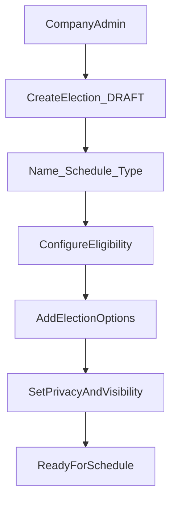

### 20.2 Election publishing

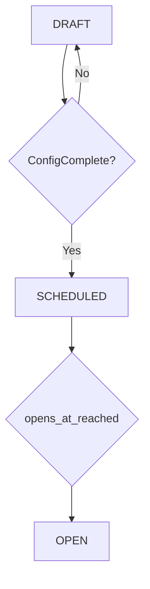

### 20.3 NFC voting

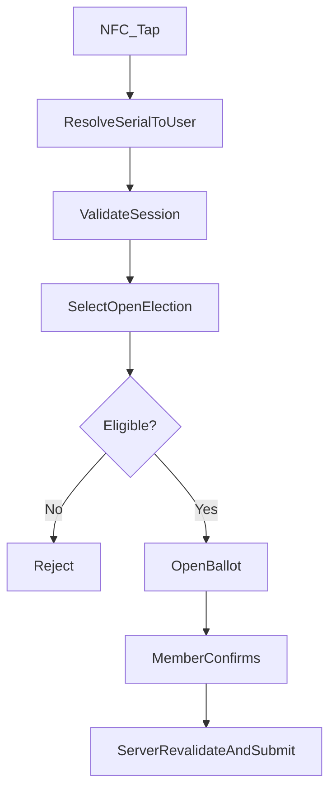

### 20.4 QR voting

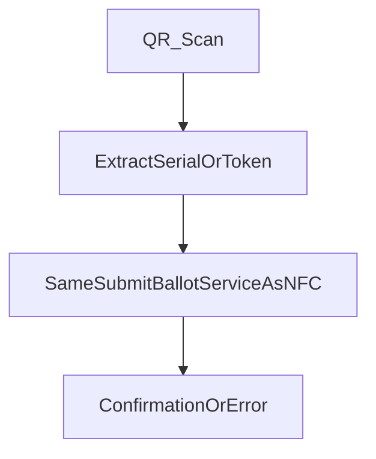

### 20.5 Voter eligibility

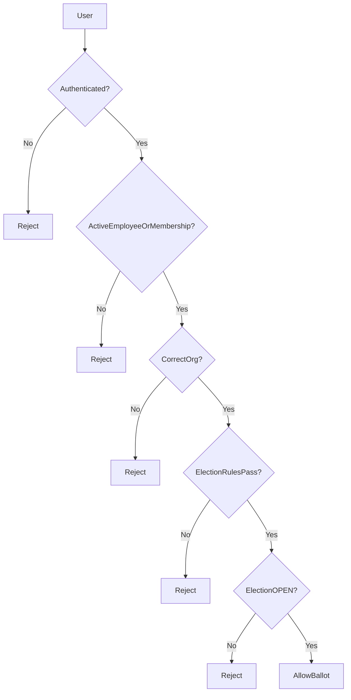

### 20.6 Vote submission

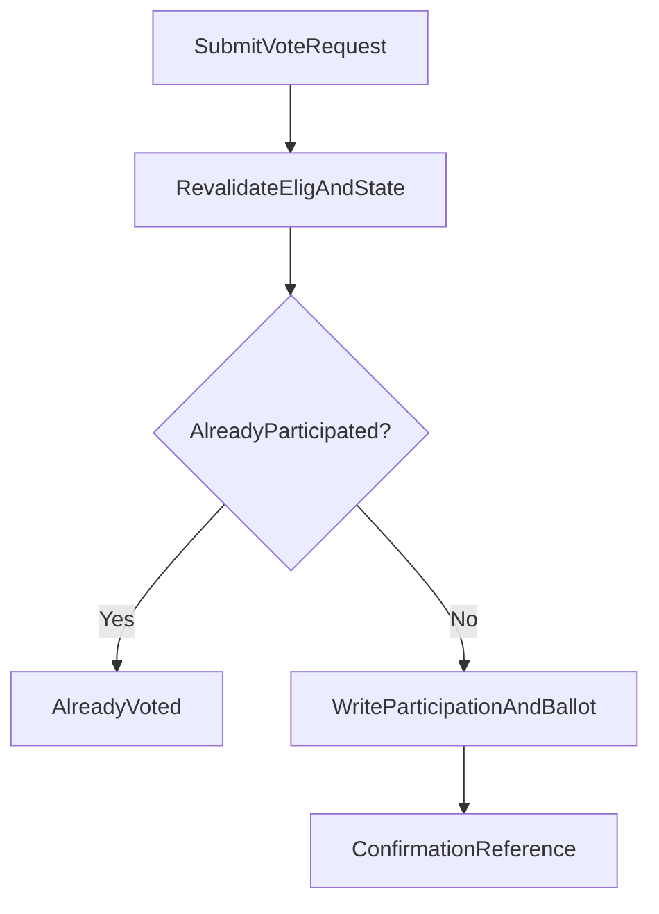

### 20.7 Duplicate vote prevention

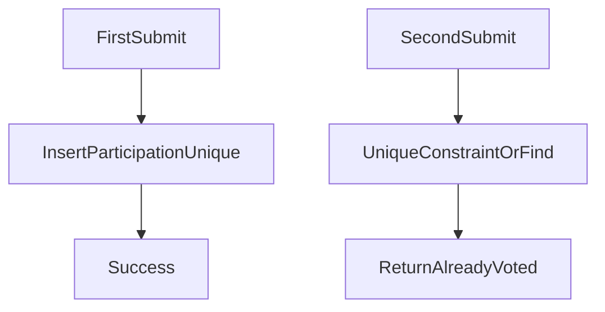

### 20.8 Anonymous voting

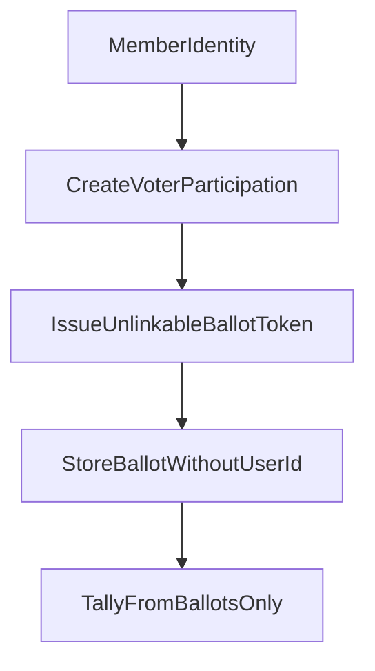

### 20.9 Election closing

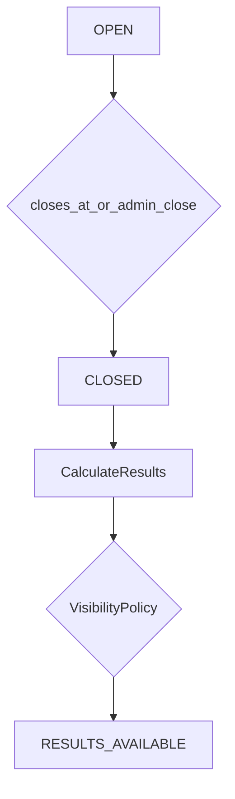

### 20.10 Result calculation

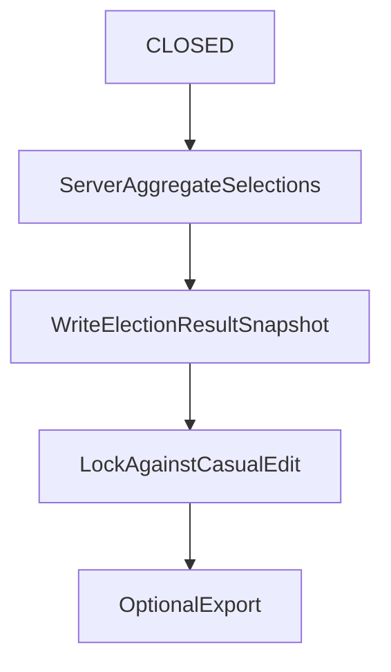

### 20.11 Loyalty program creation

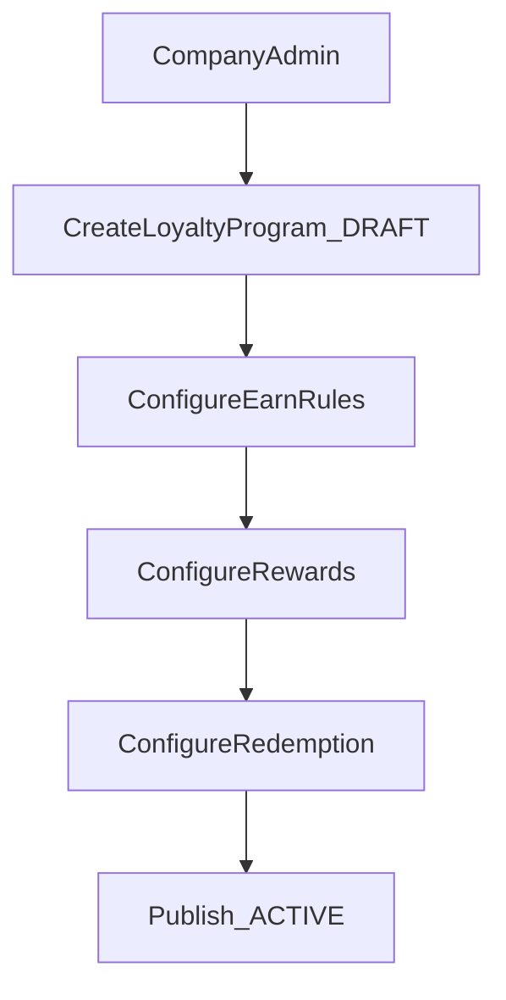

### 20.12 Loyalty earning

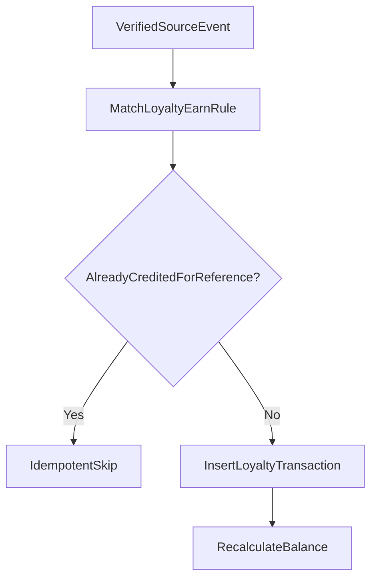

### 20.13 NFC loyalty

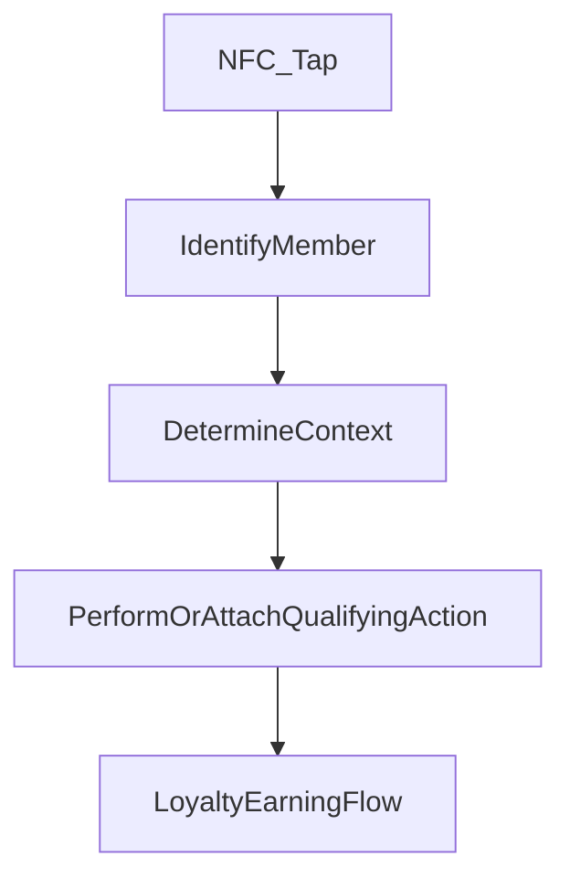

### 20.14 QR loyalty

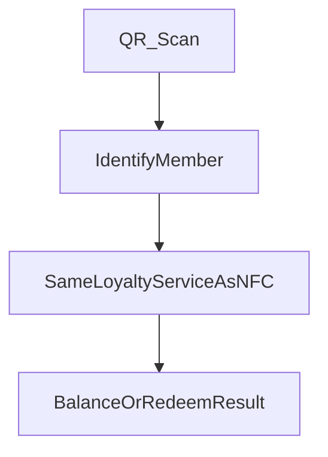

### 20.15 Reward redemption

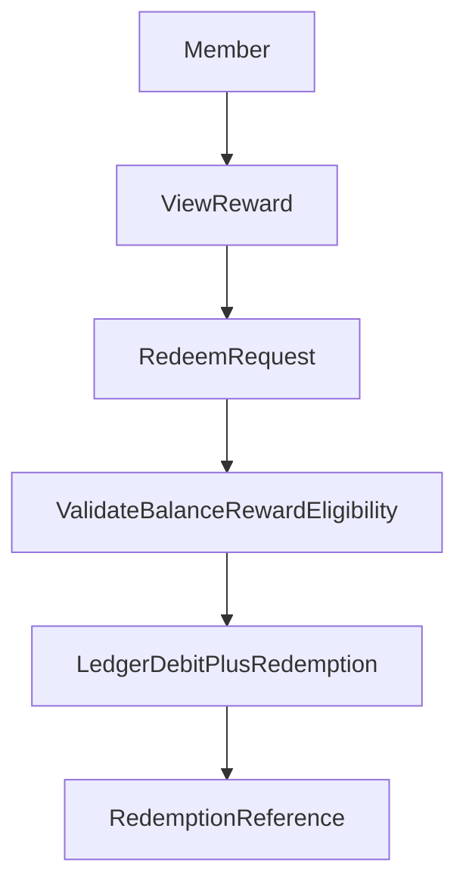

### 20.16 Reward claim via NFC/QR

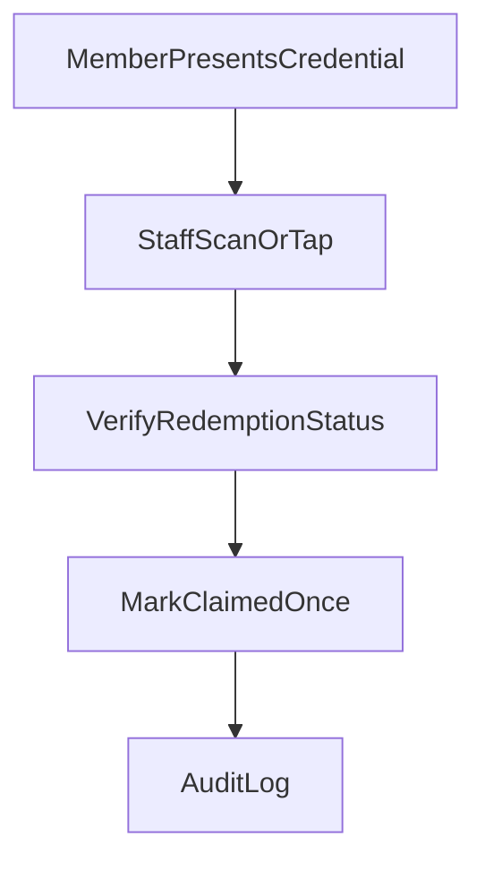

### 20.17 Attendance → Loyalty

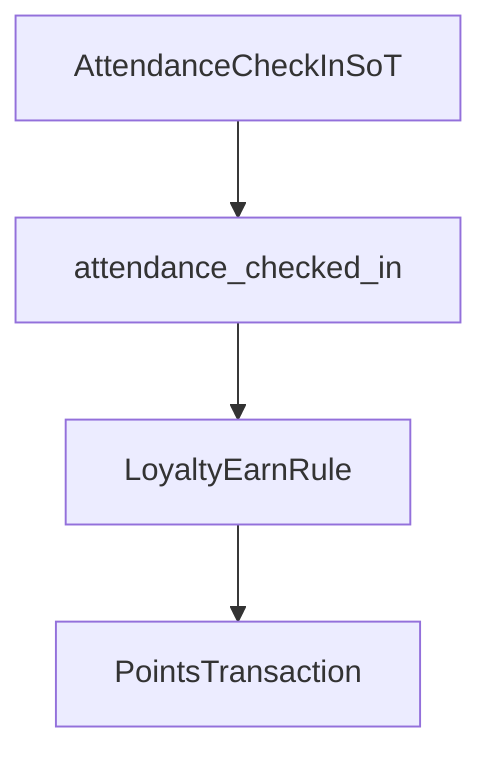

### 20.18 Membership → Voting eligibility

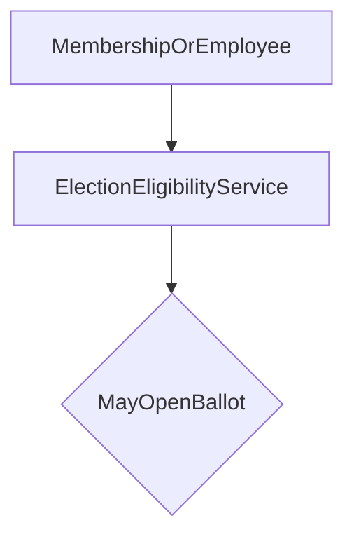

### 20.19 Membership → Loyalty eligibility

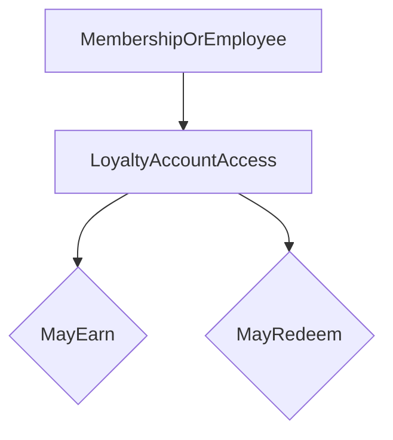

### 20.20 TAP ecosystem overview

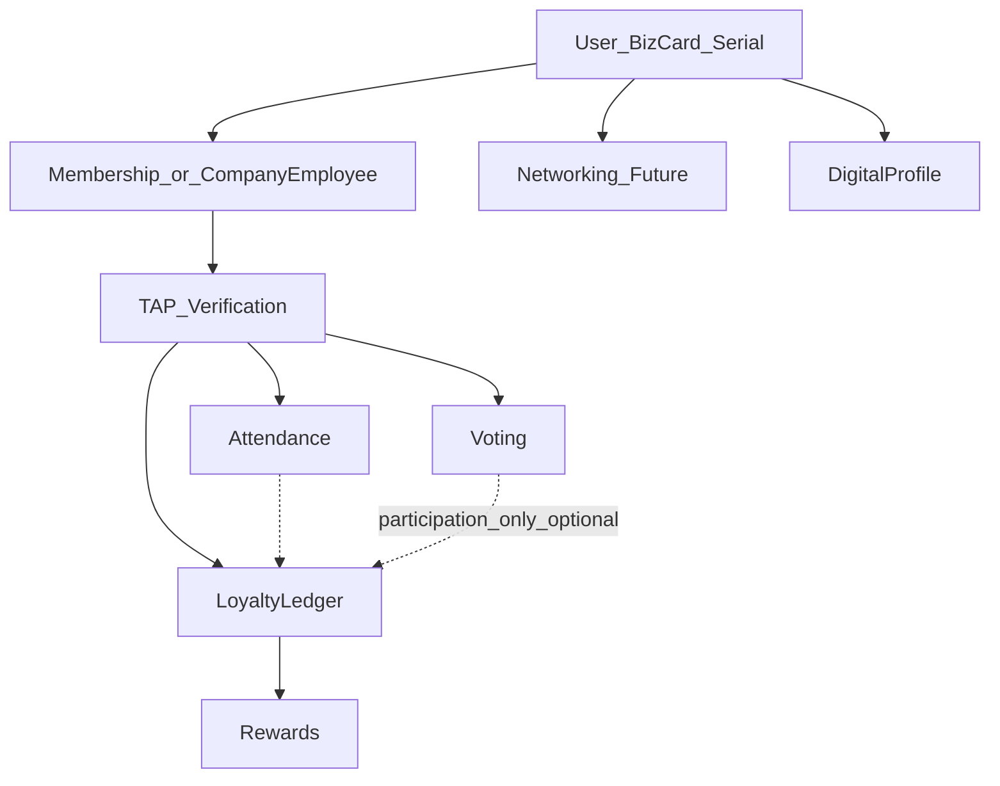

---

## 21. File Impact Report

### Existing files likely relevant — [VERIFIED EXISTING]

| Path | Purpose | Why relevant |
|---|---|---|
| `server/lib/auth.ts` | Sessions | Vote/loyalty AuthN |
| `proxy.ts` | CSRF/CSP | Mutating APIs |
| `app/config/portalNavigation.ts` | Nav | Future Company/User entries |
| `server/lib/company.ts` | Company roles + audit | AuthZ + audit pattern |
| `prisma/schema.prisma` | Models | Future entities; User/Company/Bizcard |
| `lib/bizcard/scan-routing.ts` | Serial resolve | NFC/QR identity |
| `lib/services/serialIdService.ts` | Serial normalize | Credential hygiene |
| `app/api/public/scan/[serialId]/route.ts` | Public scan | Context router hook point |
| `app/api/cards/scan/route.ts` | Employee card scan | Alternate credential |
| `lib/webhook-idempotency.ts` | Once-only pattern | Vote/redeem idempotency inspiration |
| `server/lib/rate-limit.ts` | Throttling | Abuse control |
| `server/lib/growth-referral.ts` | Referrals | Optional future earn bridge |
| `server/lib/growth-rewards.ts` | Mission rewards | Keep separate; optional bridge |
| `app/user/missions/page.tsx` | Growth UX | Avoid UX collision with Loyalty |
| `app/superadmin/missions-rewards/**` | Platform missions | Not org loyalty admin |
| `docs/Attendance & Event Monitoring.md` | Attendance architecture | Earn + event eligibility |
| `docs/FEATURE_INTEGRATION_RECOMMENDATIONS.md` | Prior §5.4 | Superseded details |

### Likely modification in implementation phase (do not modify now)

- `prisma/schema.prisma`
- `app/config/portalNavigation.ts`
- `app/admin/company/**`
- `app/user/**` (loyalty/elections surfaces)
- Scan routing / public scan for context dispatch
- Notification templates / crons for open/close elections

### New files likely needed (do not create now)

- `lib/services/election.service.ts`, `ballot.service.ts`, `election-eligibility.service.ts`
- `lib/services/loyalty-program.service.ts`, `loyalty-ledger.service.ts`, `loyalty-redemption.service.ts`
- `app/api/company/elections/**`, `app/api/company/loyalty/**`, `app/api/user/elections/**`, `app/api/user/loyalty/**`
- Admin/user UI under company and user portals

### Should NOT be touched for this feature

- Unrelated marketplace checkout internals (except future purchase earn hooks)
- Roulette probability engine (not loyalty)
- Theme/SSE portfolio streams
- Dev portal incident tooling
- Unrelated affiliate commission math (unless referral earn bridge is explicitly scoped)

---

## 22. Recommended Implementation Order

1. **Foundation** — Schema: Election + Participation + Ballot; LoyaltyProgram + Account + Transaction  
2. **Voting admin** — CRUD, lifecycle, options, eligibility  
3. **Voting member** — Ballot UI, submit, confirmation  
4. **Voting security + audit** — Idempotency, confidential mode, assisted flow, results lock  
5. **Loyalty foundation** — Program + ledger + account  
6. **Loyalty earning** — Manual adjust; Attendance hook when ready  
7. **Rewards / redemption / claim** — Catalog, redeem, staff NFC/QR claim  
8. **NFC/QR context router** — Profile vs vote vs loyalty vs attendance  
9. **Reporting** — Turnout, liability, exports  
10. **QA / security testing** — Concurrency, fraud scenarios, regression vs Growth Missions  

Do not implement in this phase.

---

## 23. Testing Strategy

| Category | Critical scenarios |
|---|---|
| Unit | Eligibility rules; ledger sum; lifecycle transitions |
| Integration | Submit vote; redeem; attendance→earn |
| API | AuthZ matrix; error codes |
| Authorization | Staff cannot read confidential ballots |
| Security | Tampered payloads; CSRF; rate limits |
| Concurrency | Parallel votes/redeems/claims |
| Idempotency | Double submit / retry |
| NFC/QR | Serial resolve → correct context |
| Election lifecycle | Cannot vote when CLOSED |
| Loyalty ledger | No negative balance; unique reference earn |
| Redemption | Single claim transition |
| Regression | Missions/spin/promos unchanged |

---

## 24. Open Business Questions

### Voting

1. Should confidential mode be available in MVP or identified-only first?
2. Can members change votes before close?
3. Default result visibility for all election types?
4. Who exactly may create elections — `admin` only, or also `manager`?
5. Who publishes results?
6. Is assisted voting allowed for confidential elections?
7. Membership expires mid-election: snapshot at OPEN vs re-check at submit? *(Architecture recommend: re-check at submit.)*
8. Platform Staff required for client elections in MVP?

### Loyalty

1. Which earn actions are in first production release?
2. Do points expire?
3. Point transfers between members?
4. Who may manually adjust points?
5. Membership expiry: freeze earn, freeze redeem, or both?
6. Partner-business redemption network?
7. Should voting participation ever earn points?
8. Auto points on every attendance vs opt-in rules per event?
9. How to label Loyalty vs Growth Missions in the user UI to avoid confusion?

Do not invent answers — resolve with stakeholders before build.

---

## 25. Final Architecture Recommendation

1. Ship **Company-owned Voting** and **Company-owned Loyalty** as separate modules sharing TAP verification (User + serial NFC/QR + CompanyEmployee/Membership eligibility).  
2. Build **election-grade Voting** (lifecycle, eligibility, one-person-one-vote, optional confidential ballots, server tallies, audit) — not a bare poll widget.  
3. Build **ledger Loyalty** — never a lone mutable points field; never conflate with Growth Missions or `spin_balance`.  
4. NFC/QR **identify only**; server authorizes vote/earn/redeem.  
5. Default: voting does **not** generate points; Loyalty **consumes** Attendance when implemented.  
6. Online-only MVP for voting (and venue loyalty earn); nest admin UX under Company; keep user nav contextual.  
7. Prefer re-validation at ballot submit for eligibility; lock ballots/results against casual admin edits.

**Status:** Discovery complete. **No application code, schema, APIs, UI, packages, env, or migrations were changed** in producing this document.

---

*End of document.*
