# Attendance & Event Monitoring — Mermaid Architecture

**Companion to:** [`docs/Attendance & Event Monitoring.md`](../Attendance%20%26%20Event%20Monitoring.md)  
**Document type:** Visual architecture / flowcharts only  
**Status:** Discovery visualization — **no implementation**  
**Date:** September 7, 2026  

This file contains **Mermaid source** for the Attendance & Event Monitoring concept. Render in any Mermaid-compatible viewer (GitHub, VS Code Mermaid preview, etc.). No exported images.

---

## Table of Contents

1. [System at a Glance](#1-system-at-a-glance)
2. [Business Door Flow](#2-business-door-flow)
3. [Today vs Target](#3-today-vs-target)
4. [Domain Ownership Model](#4-domain-ownership-model)
5. [Portal Placement](#5-portal-placement)
6. [Event Lifecycle](#6-event-lifecycle)
7. [Event Creation Flow](#7-event-creation-flow)
8. [Member Event Journey](#8-member-event-journey)
9. [NFC Attendance Flow](#9-nfc-attendance-flow)
10. [QR Attendance Flow](#10-qr-attendance-flow)
11. [Shared Check-in Validation](#11-shared-check-in-validation)
12. [Duplicate Prevention](#12-duplicate-prevention)
13. [Check-out (Optional / Off by Default)](#13-check-out-optional--off-by-default)
14. [Manual Attendance](#14-manual-attendance)
15. [Attendance Correction](#15-attendance-correction)
16. [Offline / Network Failure](#16-offline--network-failure)
17. [Capacity Management](#17-capacity-management)
18. [Membership vs Eligibility vs Attendance](#18-membership-vs-eligibility-vs-attendance)
19. [Eligibility Decision](#19-eligibility-decision)
20. [Attendance Status Lifecycle](#20-attendance-status-lifecycle)
21. [Event Monitoring](#21-event-monitoring)
22. [Staff / Operator Responsibilities](#22-staff--operator-responsibilities)
23. [Conceptual Data Model](#23-conceptual-data-model)
24. [API Surface Map](#24-api-surface-map)
25. [Idempotency](#25-idempotency)
26. [Security Gates](#26-security-gates)
27. [Audit Logging](#27-audit-logging)
28. [Reporting Flow](#28-reporting-flow)
29. [Future Integration Hooks](#29-future-integration-hooks)
30. [Implementation Phases](#30-implementation-phases)
31. [End-to-End Whole Flow](#31-end-to-end-whole-flow)

---

## Label legend

| Label | Meaning |
|---|---|
| **[VERIFIED]** | Confirmed in current TAP codebase |
| **[PROPOSED]** | Recommended future architecture |
| **[FUTURE PHASE]** | Explicitly deferred |

---

## 1. System at a Glance

**[PROPOSED]** Company-owned Managed Event domain with server-authoritative NFC/QR check-in, eligibility, monitoring, and export — separate from personal calendar RSVP.

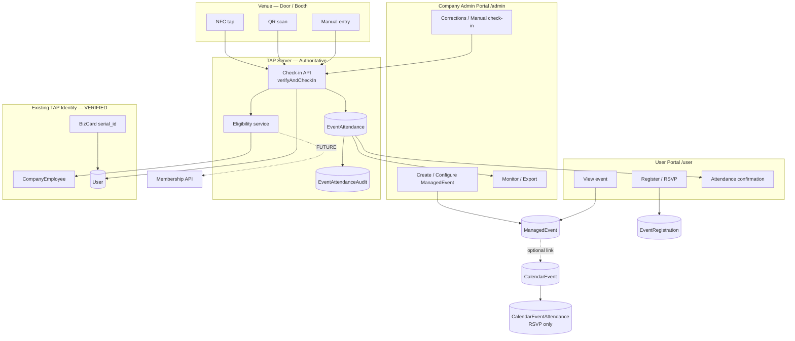

---

## 2. Business Door Flow

Conceptual business view from arrival to organizer visibility.

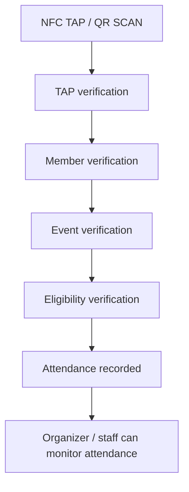

---

## 3. Today vs Target

What TAP already has vs what Attendance MVP adds.

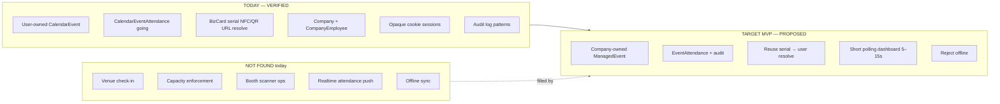

---

## 4. Domain Ownership Model

Why venue ops live on `Company`, not user calendar RSVP.

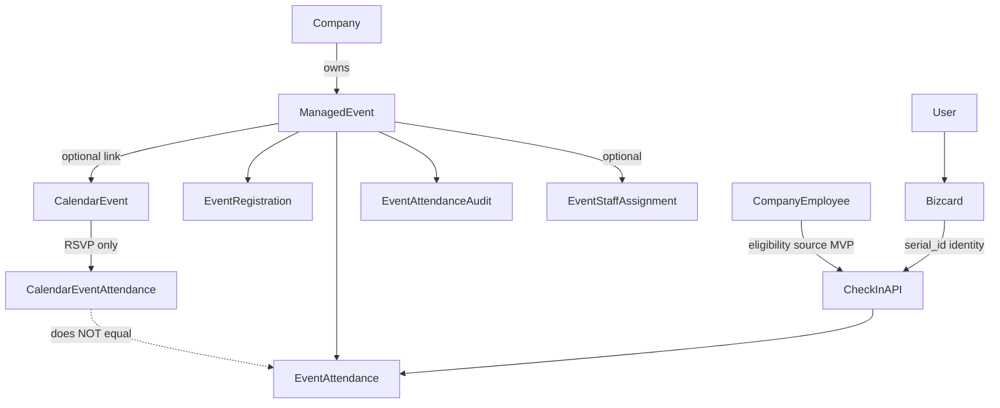

---

## 5. Portal Placement

Where each concern lives in TAP portals.

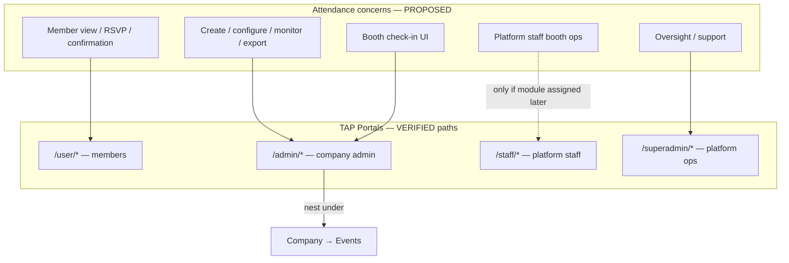

---

## 6. Event Lifecycle

Locked status machine for Managed Events.

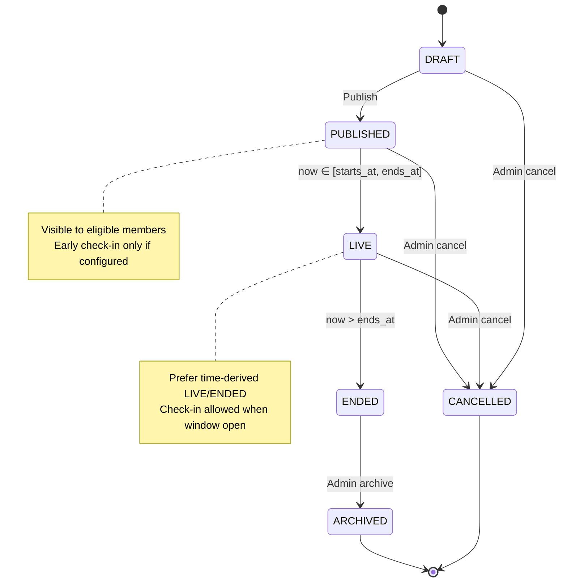

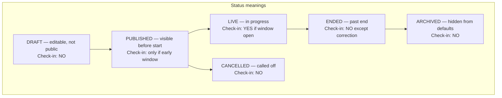

---

## 7. Event Creation Flow

Company admin creates, configures, and publishes a Managed Event.

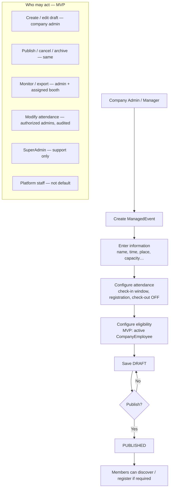

---

## 8. Member Event Journey

From discovery to venue confirmation.

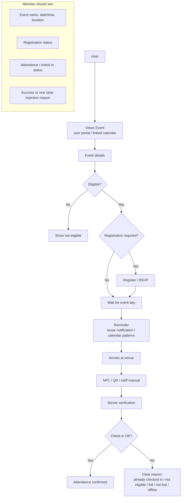

---

## 9. NFC Attendance Flow

**[VERIFIED]** NFC today = physical URL with serial → server classify/redirect.  
**[PROPOSED]** Attendance reuses serial capture; adds authoritative check-in API.

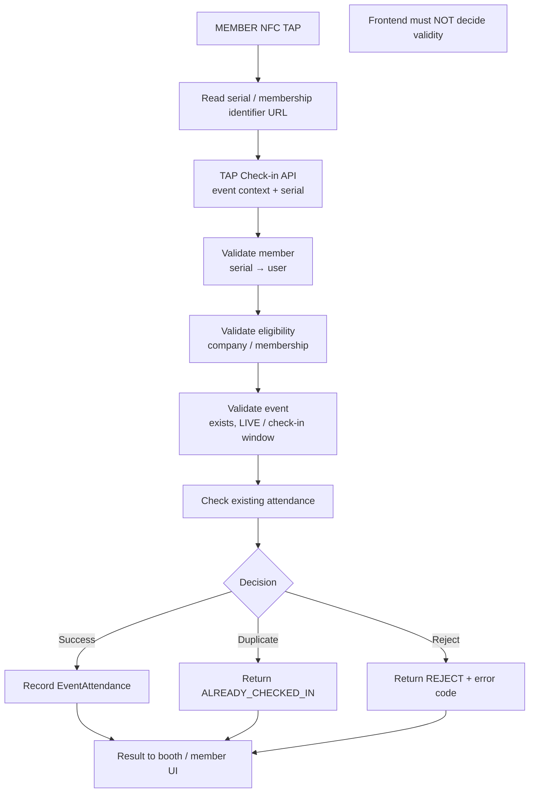

---

## 10. QR Attendance Flow

QR is an alternate capture channel for the **same** verification service.

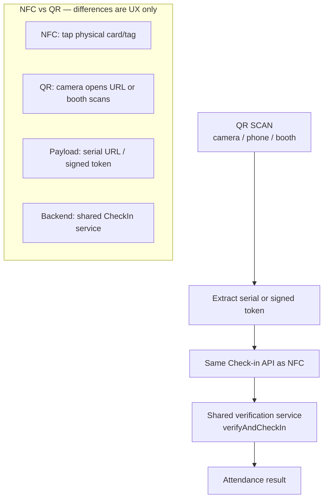

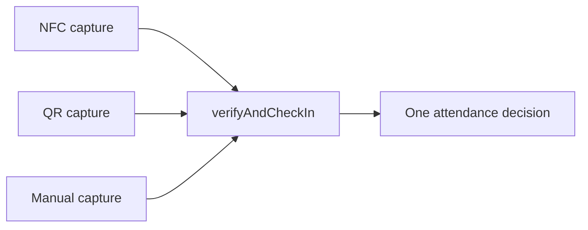

---

## 11. Shared Check-in Validation

Authoritative server decision tree for every check-in attempt.

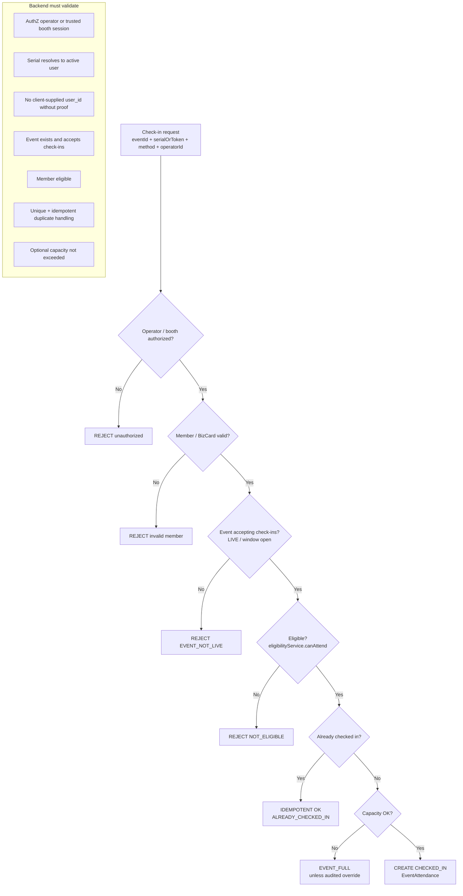

---

## 12. Duplicate Prevention

**Critical business rule:** one physical presence row per person per event.

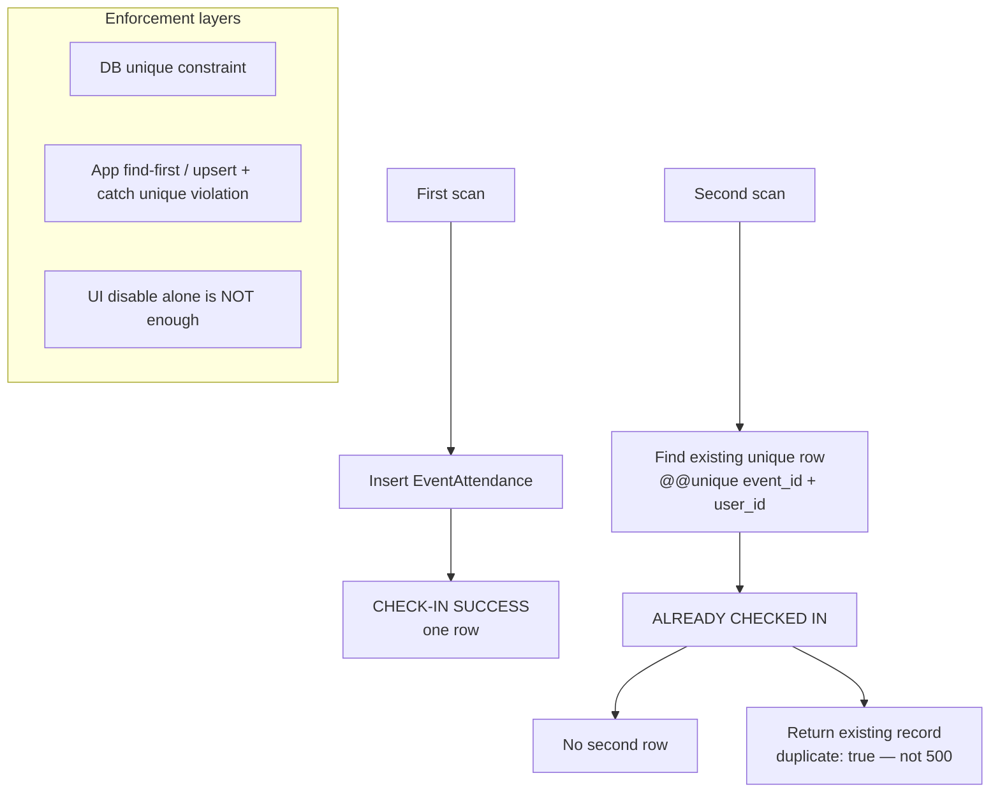

---

## 13. Check-out (Optional / Off by Default)

**[PROPOSED]** Event-configurable; **off by default for MVP**.

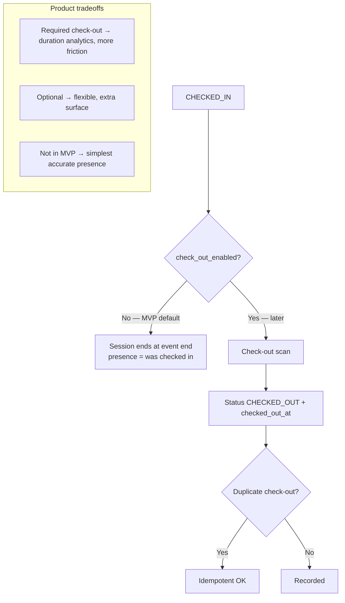

---

## 14. Manual Attendance

When cards fail, phones die, or NFC/QR is unreadable.

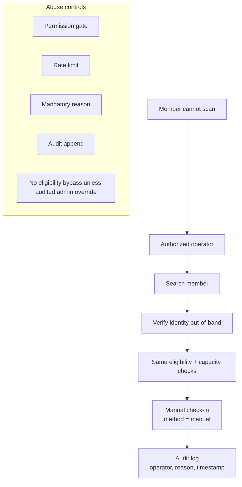

---

## 15. Attendance Correction

Prefer audit-friendly void/recreate over silent overwrite.

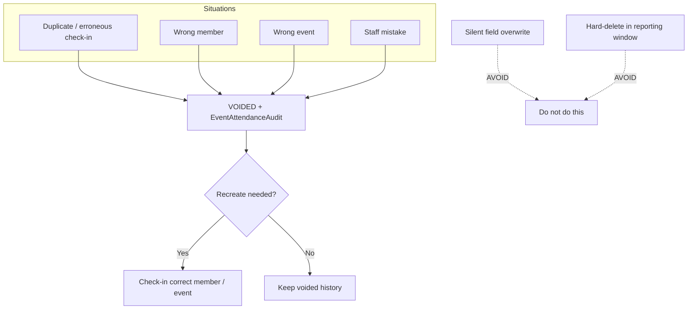

---

## 16. Offline / Network Failure

**[PROPOSED]** MVP rejects offline attempts.

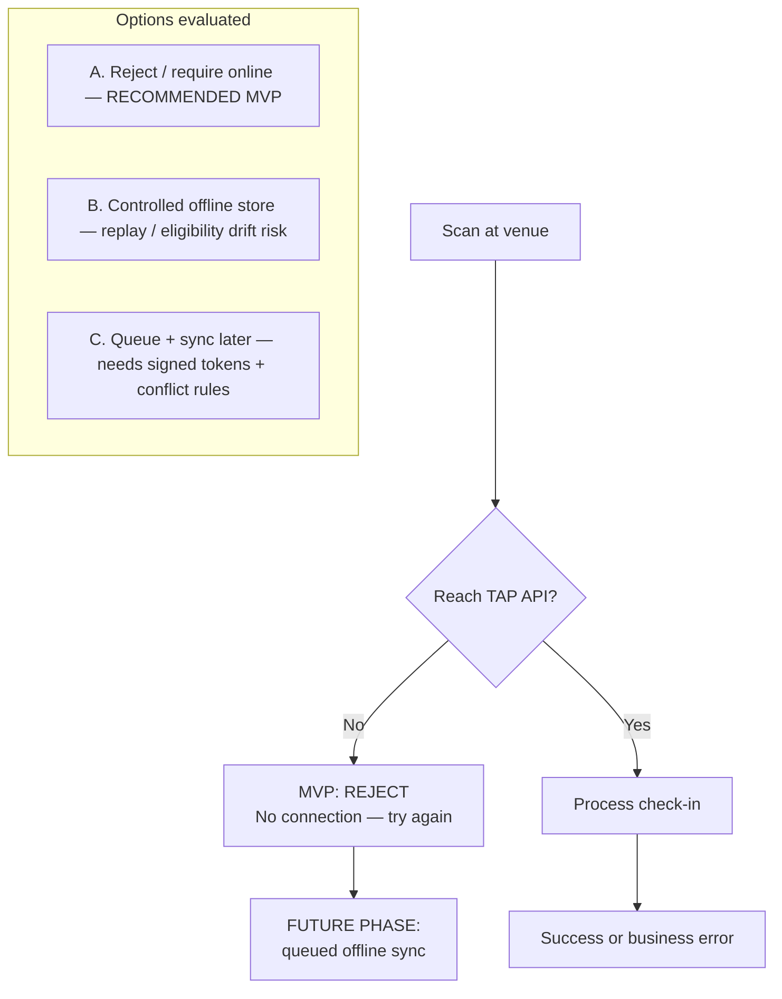

---

## 17. Capacity Management

Optional hard cap at check-in; override is audited admin-only.

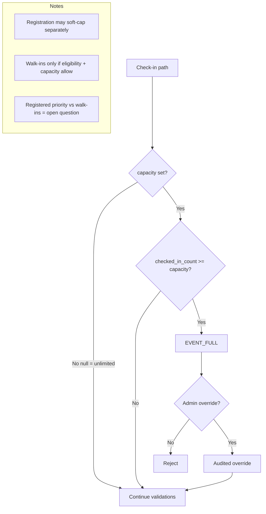

---

## 18. Membership vs Eligibility vs Attendance

Three distinct concepts — never conflate them.

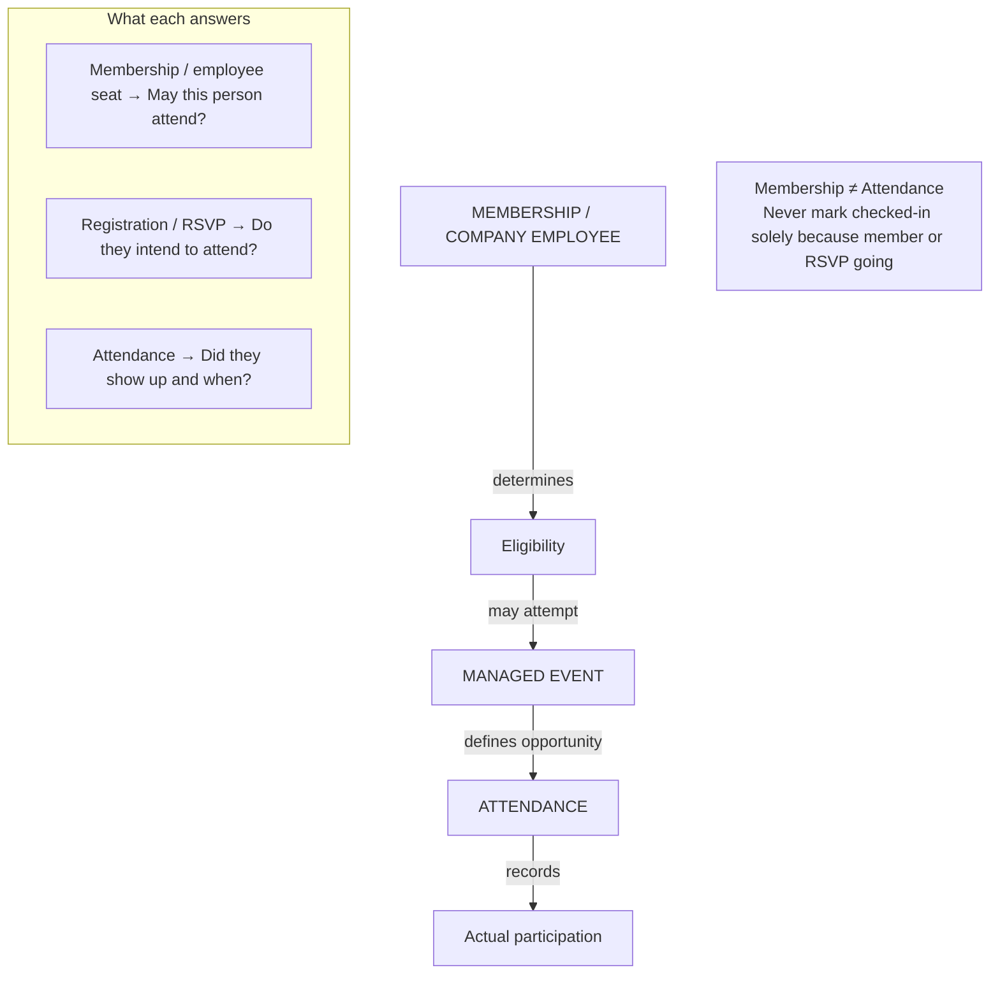

---

## 19. Eligibility Decision

Single eligibility service; UI does not invent membership rules.

```mermaid
flowchart TD
  U[User] --> EMP{Active CompanyEmployee<br/>for event company?}
  EMP -->|Yes| OK1[Eligible MVP]
  EMP -->|No| MEM{Membership API active?}
  MEM -->|Yes + active for org rules| OK2[Eligible]
  MEM -->|No / inactive| NO[Not eligible]

  OK1 --> ATT[May attempt check-in]
  OK2 --> ATT
  NO --> BLOCK[Show not eligible]

  SVC["eligibilityService.canAttend(event, user)<br/>→ { ok, reason }"]

  subgraph Matrix["Audience matrix — MVP defaults"]
    M1[Active company employees — YES]
    M2[Membership types — when API exists]
    M3[Registered only — configurable]
    M4[Invited only — optional]
    M5[Guests / public — open question / OFF]
    M6[Staff operators — check-in privilege ≠ attendee]
  end
```

---

## 20. Attendance Status Lifecycle

Venue attendance statuses — separate from calendar `going`.

```mermaid
stateDiagram-v2
  [*] --> REGISTERED: Registration API if required
  REGISTERED --> CHECKED_IN: Check-in API
  CHECKED_IN --> CHECKED_OUT: Check-out API if enabled
  REGISTERED --> NO_SHOW: Post-event cron / report
  CHECKED_IN --> VOIDED: Correction flow
  REGISTERED --> VOIDED: Correction / cancel
  CHECKED_OUT --> VOIDED: Correction flow
  VOIDED --> [*]
  NO_SHOW --> [*]
  CHECKED_OUT --> [*]

  note right of CHECKED_IN
    Physical presence
    Unique per event+user
  end note

  note right of NO_SHOW
    Registered but never checked in
    After event end
  end note
```

---

## 21. Event Monitoring

Company Admin near-real-time view via short polling (no WebSocket MVP).

```mermaid
flowchart TD
  DASH[Admin monitor page<br/>Company → Event] --> POLL[Poll monitor API every 5–15s]
  POLL --> AGG[Aggregates]
  POLL --> FEED[Recent check-ins feed]
  AGG --> UI[Update dashboard]
  FEED --> UI

  subgraph Metrics["Suggested metrics"]
    M1[Total registered]
    M2[Total checked in]
    M3[Not checked in]
    M4[Attendance rate]
    M5[Capacity remaining]
    M6[Event status]
    M7[Last check-in time]
  end

  note1[NOT SuperAdmin day-to-day<br/>NOT a new global sidebar]
  note2[Calendar RSVP lists alone are insufficient]
```

---

## 22. Staff / Operator Responsibilities

Platform staff ≠ company booth operators.

```mermaid
flowchart TD
  subgraph Platform["Platform Staff — EXISTING"]
    P1[Module CRUD permissions]
    P2[Clients, orders, inquiries]
    P3[NOT company booth operators today]
  end

  subgraph Booth["Company booth operators — PROPOSED"]
    B1[View assigned events]
    B2[Monitor attendance]
    B3[Perform NFC/QR check-in]
    B4[Search member / manual check-in]
    B5[Handle invalid scans — surface API errors]
    B6[Correct attendance — company admin narrower]
  end

  Platform -.->|optional later EventStaffAssignment<br/>or staff module key| Booth
```

---

## 23. Conceptual Data Model

**[PROPOSED]** entities — do not implement in discovery phase.

```mermaid
erDiagram
  Company ||--o{ ManagedEvent : owns
  Company ||--o{ CompanyEmployee : employs
  User ||--o{ CompanyEmployee : "is"
  User ||--o| Bizcard : "has serial_id"
  User ||--o{ EventRegistration : registers
  User ||--o{ EventAttendance : attends
  ManagedEvent ||--o{ EventRegistration : has
  ManagedEvent ||--o{ EventAttendance : has
  ManagedEvent ||--o{ EventAttendanceAudit : audits
  ManagedEvent ||--o{ EventStaffAssignment : "optional assigns"
  ManagedEvent }o--o| CalendarEvent : "optional link"
  CalendarEvent ||--o{ CalendarEventAttendance : "RSVP only"
  EventAttendance ||--o{ EventAttendanceAudit : "append log"
  User ||--o{ EventStaffAssignment : operator

  ManagedEvent {
    string id
    string company_id
    string title
    datetime starts_at
    datetime ends_at
    string status
    int capacity
    bool registration_required
    bool check_out_enabled
    string calendar_event_id
  }

  EventAttendance {
    string event_id
    string user_id
    string status
    datetime checked_in_at
    string method
    string checked_in_by
  }

  EventRegistration {
    string event_id
    string user_id
    string status
  }

  EventAttendanceAudit {
    string attendance_id
    string actor_user_id
    string action
    string reason
  }
```

```mermaid
flowchart LR
  subgraph Reuse["REUSE — VERIFIED"]
    R1[Company / CompanyEmployee]
    R2[User / Bizcard.serial_id]
    R3[CalendarEvent / RSVP]
    R4[CompanyAuditLog pattern]
    R5[Webhook idempotency pattern]
  end

  subgraph New["NEW — PROPOSED conceptual"]
    N1[ManagedEvent]
    N2[EventRegistration]
    N3[EventAttendance]
    N4[EventAttendanceAudit]
    N5[EventStaffAssignment optional]
  end

  Reuse --> New
```

---

## 24. API Surface Map

Conceptual endpoints — illustrative names; do not implement in this phase.

```mermaid
flowchart TD
  subgraph AdminAPI["Company admin / booth"]
    A1[POST /api/company/events — create draft]
    A2[GET /api/company/events — list]
    A3[GET /api/company/events/eventId — detail]
    A4[PATCH /api/company/events/eventId — edit / publish / cancel]
    A5[POST .../check-in — authoritative]
    A6[POST .../check-out — optional]
    A7[POST .../check-in/manual]
    A8[POST .../attendance/correct]
    A9[GET .../monitor]
    A10[GET .../attendance/export]
  end

  subgraph MemberAPI["Member"]
    M1[POST .../register]
    M2[GET /api/user/events...]
  end

  subgraph Shared["Shared rules"]
    S1[AuthN: existing session cookies]
    S2[AuthZ: company role / assignment]
    S3[One check-in service — never fork business rules]
    S4[Errors: NOT_ELIGIBLE / EVENT_NOT_LIVE / ALREADY_CHECKED_IN / EVENT_FULL]
  end

  A5 --> SVC[event-attendance.service]
  A6 --> SVC
  A7 --> SVC
  M1 --> REG[managed-event / registration]
  A9 --> MON[monitor aggregates]
```

---

## 25. Idempotency

Safe retries for double taps, flaky networks, and double-submit UI.

```mermaid
flowchart TD
  TAP[Scan / submit] --> KEY{Natural key<br/>event_id + user_id}
  KEY --> EXISTS{Row exists?}
  EXISTS -->|No| WRITE[Insert CHECKED_IN]
  EXISTS -->|Yes| DUP[Return same payload<br/>duplicate: true]

  TAP --> IDEM{Optional Idempotency-Key?}
  IDEM -->|Yes| STORE[Short-lived attempt result<br/>pattern like webhook-idempotency]
  IDEM -->|No| KEY
  STORE --> KEY

  note1[Reuse PATTERN from lib/webhook-idempotency.ts<br/>Do NOT reuse WebhookEvent table]
```

---

## 26. Security Gates

Backend is authoritative for every gate.

```mermaid
flowchart TD
  REQ[Incoming check-in] --> G1[Authentication<br/>DB session cookies]
  G1 --> G2[Authorization<br/>company role / event assignment]
  G2 --> G3[Member identity<br/>resolve serial server-side]
  G3 --> G4[Eligibility service]
  G4 --> G5[Token validation<br/>signed short-lived if public URLs]
  G5 --> G6[Replay / idempotency]
  G6 --> G7[Unique constraint]
  G7 --> G8[Rate limiting<br/>rate-limit.ts patterns]
  G8 --> G9[Audit for manual + corrections]
  G9 --> G10[PII minimize device_meta<br/>strict export ACLs]
  G10 --> G11[Offline → REJECT in MVP]
  G11 --> OK[Allow write / return result]
```

---

## 27. Audit Logging

Append-only trail for privileged and corrective actions.

```mermaid
flowchart TD
  subgraph Actions["Auditable actions"]
    A1[Event created / edited / published / cancelled / archived]
    A2[Registration create / cancel]
    A3[Check-in / check-out especially manual]
    A4[Attendance void / correct]
    A5[Capacity override]
    A6[Staff / operator privileged actions]
  end

  Actions --> LOG[(EventAttendanceAudit<br/>and/or CompanyAuditLog shape)]

  subgraph Retain["Retain"]
    R1[Actor]
    R2[Company / event / target user]
    R3[Action + reason]
    R4[Before / after]
    R5[Request id / timestamp]
    R6[IP / UA when appropriate]
  end

  LOG --> Retain
```

---

## 28. Reporting Flow

Post-event and live reporting surfaces.

```mermaid
flowchart TD
  END[Event ENDED] --> NOSHOW[Mark NO_SHOW<br/>registered never checked in]
  END --> EXPORT[CSV export]
  NOSHOW --> EXPORT

  LIVE[While LIVE] --> MON[Live counts via monitor poll]

  EXPORT --> R1[Total attendees / checked-in]
  EXPORT --> R2[Attendance rate vs registered]
  EXPORT --> R3[Name, email, time, method]
  EXPORT --> R4[No-shows]

  subgraph Future["FUTURE reports"]
    F1[Check-in time distribution]
    F2[Member history across events]
    F3[Operator activity]
  end
```

---

## 29. Future Integration Hooks

All **[FUTURE PHASE]** — emit `attendance.checked_in`; do not build now.

```mermaid
flowchart TD
  CI[Check-in success] --> HOOK[attendance.checked_in domain hook]

  HOOK --> FOOD[Food / Token Claiming<br/>issue EventToken if batch linked]
  HOOK --> VOTE[Voting<br/>checked_in → ballot eligibility]
  HOOK --> LOY[Loyalty<br/>attendance → points ledger]
  HOOK --> NET[Networking<br/>event-scoped directory]
  HOOK --> MIS[Mission / Rewards<br/>attend → progress → reward]

  FOOD --> W[Member wallet / claim]
  VOTE --> B[Cast ballot]
  LOY --> BAL[Update points balance]
  NET --> CON[Optional connect / meet]
  MIS --> REW[Reward eligibility]
```

---

## 30. Implementation Phases

Phased delivery without rewriting identity or calendar RSVP.

```mermaid
flowchart TD
  P0[Phase 0 — Decisions<br/>ownership, lifecycle, offline reject,<br/>check-out off, eligibility MVP] --> P1

  P1[Phase 1 — MVP venue attendance<br/>schema + services + admin UI + member UI<br/>serial resolve + polling + online-only] --> P2

  P2[Phase 2 — Hardening<br/>EventStaffAssignment, overrides UX,<br/>richer audits, reminders, signed tokens,<br/>door-volume rate limits] --> P3

  P3[Phase 3 — Membership consumption<br/>extend eligibility to Membership API<br/>without rewriting attendance] --> P4

  P4[Phase 4 — Future products<br/>food / vote / loyalty / network / missions<br/>optional offline sync / realtime push]

  subgraph Avoid["Avoid rewrites"]
    A1[Keep calendar RSVP intact]
    A2[Keep one check-in service]
    A3[Do not duplicate identity]
  end
```

---

## 31. End-to-End Whole Flow

Complete narrative from create → publish → arrive → verify → record → monitor → report.

```mermaid
flowchart TD
  Start([Company Admin / Manager]) --> Create[Create ManagedEvent]
  Create --> Details[Enter name / time / place / capacity]
  Details --> AttendCfg[Configure check-in window / registration / check-out OFF]
  AttendCfg --> EligCfg[Configure eligibility: active CompanyEmployee MVP]
  EligCfg --> Draft[Save as DRAFT]
  Draft --> Publish{Publish?}
  Publish -->|No| Draft
  Publish -->|Yes| Published[PUBLISHED]

  Published --> Life{Time / admin action}
  Life -->|now in starts_at..ends_at| Live[LIVE]
  Life -->|now > ends_at| Ended[ENDED]
  Life -->|admin cancel| Cancelled[CANCELLED]
  Life -->|admin archive| Archived[ARCHIVED]

  Published --> Discover[Eligible member discovers event]
  Live --> Discover
  Discover --> Portal["/user portal or linked CalendarEvent"]
  Portal --> EligGate{Eligible?}
  EligGate -->|No| RejectElig[Show not eligible]
  EligGate -->|Yes| RegNeed{Registration required?}
  RegNeed -->|Yes| Register[EventRegistration / optional RSVP]
  RegNeed -->|No| WaitDay[Wait for event day]
  Register --> WaitDay
  WaitDay --> Arrive[Member arrives at venue]

  Arrive --> Capture{Capture method}
  Capture -->|NFC| NFC[NFC tap serial URL]
  Capture -->|QR| QR[QR scan serial / token]
  Capture -->|Manual| Manual[Authorized operator search + OOB verify]
  NFC --> Resolve[Resolve serial → User server-side]
  QR --> Resolve
  Manual --> ManualPath[method=manual + reason]
  Resolve --> Online{Network online?}
  ManualPath --> Online
  Online -->|No| OfflineRej[MVP REJECT: require online]
  Online -->|Yes| API["Check-in API verifyAndCheckIn"]

  API --> AuthZ{Operator / booth authorized?}
  AuthZ -->|No| ErrAuth[REJECT unauthorized]
  AuthZ -->|Yes| VMember{Member / BizCard valid?}
  VMember -->|No| ErrMember[REJECT invalid member]
  VMember -->|Yes| VEvent{Event exists + LIVE / check-in open?}
  VEvent -->|No| ErrEvent[REJECT EVENT_NOT_LIVE]
  VEvent -->|Yes| VElig{eligibilityService.canAttend?}
  VElig -->|No| ErrElig[REJECT NOT_ELIGIBLE]
  VElig -->|Yes| VDup{Already EventAttendance row?}
  VDup -->|Yes| Idempotent[ALREADY_CHECKED_IN idempotent OK]
  VDup -->|No| VCap{Capacity OK?}
  VCap -->|No| ErrFull[EVENT_FULL unless audited override]
  VCap -->|Yes| Write[CREATE EventAttendance CHECKED_IN]
  Write --> Unique["@@unique event_id + user_id"]
  Unique --> Confirm[Member confirmation UI]
  Idempotent --> Confirm
  Write --> AuditOK[Audit if manual]

  Write --> Monitor[Admin monitor polls 5–15s]
  Idempotent --> Monitor
  Monitor --> Metrics[Registered / checked-in / rate / capacity / feed]

  Live --> CheckInOpen{Check-in window open?}
  CheckInOpen -->|Yes| Capture

  Ended --> NoShow[Mark NO_SHOW for registered never checked in]
  Ended --> Export[CSV export / attendance report]
  NoShow --> Export

  Write --> Correct{Need correction?}
  Correct -->|Yes| Void[VOIDED + EventAttendanceAudit]
  Void --> Recreate[Optional check-in correct member/event]
  Correct -->|No| Done([Flow complete])
  Export --> Done
  Confirm --> Done

  Write -.->|FUTURE hook attendance.checked_in| Future[Food / Voting / Loyalty / Networking / Missions]
```

---

## Narrative summary

Organization (**Company**) creates and publishes a **Managed Event** → eligible members discover it on the user portal (optional `CalendarEvent` link) → register if required → on event day NFC/QR serial is captured → **Check-in API** validates member, eligibility, event window, duplicates, and capacity → writes **one** `EventAttendance` row → member sees confirmation → admin monitor **polls** updates → after end, export / no-show reporting.

**Final architecture pillars:** Company-owned events · calendar RSVP kept separate · single server check-in service for NFC/QR/manual · MVP eligibility = active `CompanyEmployee` · unique `(event_id, user_id)` · check-out off · offline reject · Company Admin monitoring.

---

*End of Mermaid architecture document. Source of truth for product decisions remains [`Attendance & Event Monitoring.md`](../Attendance%20%26%20Event%20Monitoring.md).*
